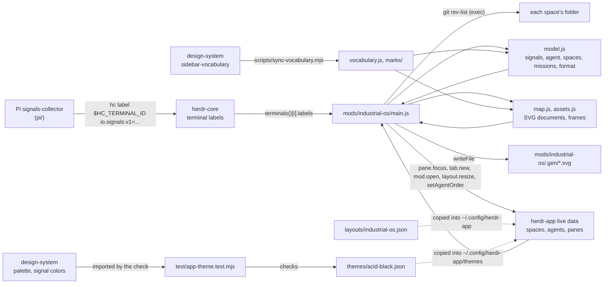
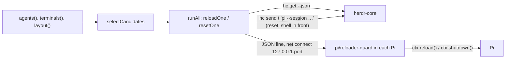

# Architecture

Status: current at Pi Reloader contract version 2 and the sidebar redesign of 2026-11-18.
Evidence: the mods and layout, their tests, the redesign's [probe-window record](../CONTRIBUTING.md#sidebar-redesign), and Herdr app 0.1.15's own documentation in `~/.config/herdr-app` (`AGENTS.md` "Layouts", "Keys", "Commands" and "Mods", `herdr.d.ts`, `gpui-kit.d.ts`, whose `net` module offers only `connect(host, port)`), `herdr-app commands`, herdr-core 0.1.20's `hc --help` and `hc --skill`, its shipped `main` layout and `agents`, `spaces`, `confirm` and `picker` mods.

## Files and dependencies

| File | Owns | Depends on |
| --- | --- | --- |
| `mods/industrial-os/main.js` | The sidebar's three blocks, chosen by `props().part` (`top`, the list, `bottom`), and their rail forms: reads Herdr's live data, keeps the remembered state in `localStorage`, looks up ahead/behind with `git`, writes drawings to `.gen/`, runs click commands and lays elements out. `MapView`, a nested view with its own clock, is one window onto the map | The app's `gpui-kit`, `gpui-base`, `herdr` and `fs/promises` modules; the pure modules beside it |
| `mods/industrial-os/model.js` | The whole sidebar as plain data: agent blocks, space rows, the missions, ACTION REQUIRED, the agents view, the rail's lamps, the counts, the agent order, the next memory and the next time shown text changes | `agent.js`, `signals.js`, `spaces.js`, `missions.js` |
| `mods/industrial-os/missions.js` | Every pane as a unit under its space and tab: designation, state mark, name, age, readings and detail lines; ACTION REQUIRED's order, the agents view's groups, the rail's lamps | `format.js`, `agent.js` icons, `vocabulary.js` |
| `mods/industrial-os/map.js` | The shared map: the world for a set of missions, where each unit is at a time, each window's camera, and one frame as still drawings (SVG documents named by key) plus dots | `vocabulary.js` |
| `mods/industrial-os/assets.js` | The still drawings under and over the text, as SVG documents: halos, bar glows, dot grids, the scanner's corners, the ground, fades, the ruler, sideways text | `vocabulary.js` |
| `mods/industrial-os/fold.js` | The fold's motion as plain data: when each step starts, how each row is erased or typed in, the scan line's pieces | Nothing |
| `mods/industrial-os/vocabulary.js`, `marks/*.svg` | Committed copies of the design system's sidebar vocabulary and its drawn marks. Never edited | `scripts/sync-vocabulary.mjs` writes them |
| `scripts/sync-vocabulary.mjs` | Writes those copies from the design system | `@industrial-os/design-system/foundation/sidebar-vocabulary` by package name |
| `mods/industrial-os/.gen/` | Drawings written at run time, named by content. Not in the repository; emptied by the mod at start past 1500 files | `main.js` |
| `mods/industrial-os/signals.js` | Reading and validating the `io.signals.v1` label; the stale-label rule | Nothing; the frozen label contract |
| `mods/industrial-os/agent.js` | State precedence, the unseen-work-finished rule, the pane name and every agent row | `format.js` |
| `mods/industrial-os/spaces.js` | Space state, counts, units, activity and quiet ages, ahead/behind parsing and a space's place | `format.js`, `agent.js` icons |
| `mods/industrial-os/format.js` | Text formats: durations, ages, counts, model, directory, context bar, days, wrapping, cleaning | Nothing |
| `mods/industrial-os/mod.json` | `"place": "none"`: the mod appears only where a layout puts it | herdr-app's mod format |
| `layouts/industrial-os.json` | The shipped `main` layout with zero terminal padding, flat panes (radius 0, no border or focus outline), the sidebar at 300 px and its `brand` header (130 px, `part: "top"`), lists and `sidebar-footer` (46 px, `part: "bottom"`) replaced by `industrial-os` blocks, and Lunalee's column (`lunalee`: a 1 px `lunalee-host` block for the `lunalee` mod and a `lunalee-chat` block for the terminal of that name) added on the right | herdr-app's layout format; Herdr app 0.1.15's `main.json`; Lunalee's install for the column's mod and terminal |
| `mods/pi-reloader/main.js` | The Pi Reloader window: lists candidates, runs an action in one task, and supplies its `io`: `hc get` and `hc send`, and the guard's loopback socket through `net` | The app's `gpui-kit`, `gpui-base`, `herdr` and `net` modules; `reloader.js` |
| `mods/pi-reloader/reloader.js` | Every Pi Reloader rule: candidates and protection, the guard label and wire checks, the reload and reset sequences, the summary | Nothing; the [guard contract](../../pi/reloader-guard/docs/contract.md) |
| `mods/pi-reloader/mod.json`, `LICENSE` | The window it opens as (`kind: "window"`, 620 × 460; a test copy adds `overlay.props.only`, the addresses it may act on); MIT, keeping the notice of the code it was adapted from | herdr-app's mod format |
| `keys/pi-reloader.json` | The keys.json snippet a person merges: `cmd-alt-r` → `mod.open:pi-reloader` | herdr-app's keys format |
| `mods/package.json` | Marks the mods' `.js` files as ES modules for Node; not part of the mod | Node 22 |
| `mods/.gitignore` | Keeps out the `gpui-kit.d.ts` and `jsconfig.json` that `herdr-app check` writes into a mod folder for editors | Git |
| `themes/acid-black.json` | The Herdr desktop app's theme: terminal and panel colors | herdr-app's theme file format (`~/.config/herdr-app/AGENTS.md`, "The look"); design-system colors, including `HERDR_TERMINAL` |
| `test/industrial-os.test.mjs` | The pure modules on fixtures: every state, unknowns, caps, the finished rule, space aggregation, missions and units, ACTION REQUIRED, the agents view, the rail's lamps, ages and wrapping | The mod's pure modules |
| `test/industrial-os-sidebar.test.mjs` | The copies equal the design system's vocabulary and marks; the map's world, units, cameras and frames; every drawing is a well-formed SVG | The mod's pure modules; the design-system package by name; `scripts/sync-vocabulary.mjs` |
| `test/industrial-os-layout.test.mjs` | The layout differs from the recorded shipped `main.json` only in the listed changes and the frozen Lunalee column; mod.json; imports stay in the mod folder | `test/fixtures/herdr-app-0.1.15-main.json` |
| `test/pi-reloader.test.mjs` | The Pi Reloader's rules against a simulated herdr-core and guard; its folder's imports, globals and the shipped `mod.json` | `mods/pi-reloader/` |
| `test/app-theme.test.mjs` | Each desktop theme color holds its approved design-system value | `foundation/palette` and `/signal-colors` (`SIGNAL_COLORS`, `HERDR_TERMINAL`) by package name |

No code is shared with another project at run time: the vocabulary is a committed copy. The mod's imports resolve inside its folder, as herdr-app requires, and the pure modules import neither `gpui-kit` nor `herdr`, so Node's test runner loads them directly. The label is the only data contract with Pi: the signals-collector publishes it; this project only reads it.

## Flow

herdr-app redraws each of the mod's three blocks whenever its live data changes: spaces, agents, panes, terminals (including their labels), focus and theme. Each block is its own copy of the view. Each render reads those lists once and passes them with the clock, this computer's home folder, the last ahead/behind results, the remembered state, the folded spaces, the focused pane and the shown view to `buildSidebar`. Only the list block saves the new memory, sets the agent order and looks up `git`; the top block reads the same data for its counts and map and keeps nothing. `buildSidebar`:

1. Parses the label on every live terminal whose agent status `app` is `pi` (from `agents()`, else the core's report). Anything else is no signals.
2. Builds one Pi block per agent with signals and one line per other agent, in `agents()` order, updating each terminal's remembered counts and finished time.
3. Builds one row per space from its panes, using the Pi blocks' states (SUB/RUN as working) and units, and updates its remembered activity.
4. Builds the missions from every pane, with the blocks' states and readings, then ACTION REQUIRED, the agents view, the rail's lamps and the counts.
5. Returns the earliest time any shown clock, age or quiet age will change.

**Drawings.** A render asks for each drawing by a key (`picture(key, make, …)`). The first time, the key is queued and its place stays empty; the block's clock writes queued drawings to `.gen/` as SVG files named by their content, and the next render places them. Each block has its own queue. **The map** is a `MapView` per open space, and one in the plate, created and released by the block's clock, never during a render. Each has a 33 ms clock of its own and reads its block's shared `stage` (the world, the hovered unit, the watched unit), so the map moves without redrawing the list. **Two more nested views** read the same stage, both made once when the list block starts: `GroundView` draws [the ground's light](design.md#ground) on the same 33 ms clock from the pointer's place, which the list's `on_mouse_move` only records; `ReadoutView` draws the scanner's readout and is redrawn by a 30 ms timer that the list starts when the pointer reaches a pane and cancels 1.2 s later. **Between blocks** there are two channels, both `shared()` keys. `industrial-os.aim`: the list sets it to the ACTION REQUIRED unit under the pointer and the plate's crosshair follows. `industrial-os.motion`: `{ at, kind, step }` of a [fold in motion](design.md#folding-and-unfolding); the block that was asked sets each step from timers and every block draws its own covers for it. **Herdr's own mods** are opened by name, never imported: `picker` from the search hint, `menu` (as a popup, with a tab as its target) from a right click on a tab title. One older than 3 s is ignored, so a mod reloaded mid-fold leaves nothing behind. **The scanner** is one element per list. In the scrolling list its place is measured, not computed: a pane's `on_mouse_move` bounds against the list body's, taken from the same pointer move.

One 110 ms clock per block writes drawings, steps the state marks while a moving one is shown (and the open grip's chevrons), and every ninth tick compares the clock with that time and redraws only then; it also starts ahead/behind lookups: a place (machine and folder) not looked at yet at once, others every 30 seconds while the window is active, one pass at a time with a 5-second timeout per `git` run. A failed run keeps what was shown.

## Pi Reloader

`mod.open:pi-reloader` opens the mod as a window: a press it doesn't stop doesn't close it, and Esc reaches the mod, which ignores keys while a run is going. A run is one `cx.spawn` task; `reloader.js` gets an `io` whose every call goes through herdr-core or the guard, so the whole sequence is tested with a simulated one.

1. **Select.** From `agents()`: Pi (`app` is `pi`) on this computer, in a pane, not shown by a layout block nor named `lunalee-chat`, idle or done. Other Pi agents are counted as busy or protected; other agents are ignored. A window's `only` prop narrows the set.
2. **Run.** Both actions start on every candidate at once and wait for every attempt; each ends completed, skipped with a reason, or failed with a reason.
3. **Check at action time.** `hc get <t> --json` must show it live, Pi's status idle or done, and a valid `io.pi-reloader.v2` label; else skip, or fail without a guard, with nothing done.
4. **Reload:** probe; if ready, `reload` with the probed session; then poll `hc get` until the label shows a new token and a probe on it answers (30 s).
5. **Reset:** the root program must be sh, bash, zsh, dash or ksh with Pi as a job; probe; a session file is required; `quit`; poll until the shell is in front with no agent status (15 s); `hc send` the single-quoted resume line; poll until Pi reports idle or done with a new label and a probe returns the same session (30 s).

Neither action moves focus or marks anything read. Neither advances herdr-core's per-terminal `turn`, so Herdr's idle or done for each Pi stays as it was; see [the decision](../../docs/decisions/pi-reloader-desktop.md). The polls run only while the mod acts: `hc wait` waits for an agent to stop working, and these Pis are already settled.

Commands from `nextCommand()` (`reload`, `reset`, `close`) reach the window only while it is open.

## Critical invariants

| Must remain true | Check |
| --- | --- |
| Unknown is never zero: a missing, malformed or stale label shows `??`, `--%` or nothing, and is no completion | `test/industrial-os.test.mjs` |
| A label counts only on a live terminal whose agent `app` is `pi`, with `version` 1 | `test/industrial-os.test.mjs` |
| State precedence `QNS` > `BLK` > `WRK` > `SUB` > `RUN` > `DNE` > `IDL`/`UNK` | `test/industrial-os.test.mjs` |
| The layout is shipped `main` with only zero terminal padding, flat panes, the sidebar at 300 px, its header, lists and footer replaced, and the frozen `lunalee` column (ids `lunalee`, `lunalee-host`, `lunalee-chat`; terminal `lunalee-chat`; 580 px, 420–900) as `root`'s third child | `test/industrial-os-layout.test.mjs` |
| The mod imports only `gpui-kit`, `gpui-base`, `herdr` and `fs/promises` (in `main.js`) and its own files; no `setTimeout`, `Intl`, `TextDecoder` or `WebSocket` | `test/industrial-os-layout.test.mjs` |
| `vocabulary.js` and `marks/` equal the design system's sidebar vocabulary | `test/industrial-os-sidebar.test.mjs` |
| A drawing's key names one document: the same key always writes the same SVG, and every document is well formed | `test/industrial-os-sidebar.test.mjs` |
| The mod writes only inside its own `.gen/` folder | Review `main.js`: `flush` is the only writer |
| The mod loads and renders in herdr-app | `herdr-app check mods/industrial-os` |
| Every desktop theme color is its approved design-system value | `test/app-theme.test.mjs` |
| The Pi Reloader never types into Pi, never kills, acts only through a matching guard, skips drafts, busy and protected terminals, and types its one shell line only into the root POSIX shell in front | `test/pi-reloader.test.mjs` |
| The shipped Pi Reloader `mod.json` has no `only` prop, so it acts on every candidate | `test/pi-reloader.test.mjs` |
| The Pi Reloader loads and renders | `herdr-app check mods/pi-reloader` |

## Where the next change belongs

- A rule about what a value means: the pure module that owns it, with its test, then [the design](design.md#sidebar).
- A color, opacity, status word, designation or state mark: the design system's `sidebar-vocabulary.mjs` first, then `node scripts/sync-vocabulary.mjs`.
- Something the map shows: `map.js`. A halo, grid or fade: `assets.js`. Both return SVG documents; neither places anything.
- Where things sit, what the pointer does, which command a click runs: `main.js`.
- Another Herdr desktop mod or layout: its own folder under `mods/` or file under `layouts/`, with a test beside the others and an install section in the README. A keys.json snippet it needs goes in `keys/`.
- A Pi Reloader rule: `reloader.js` and its test; a protocol change starts in the [guard contract](../../pi/reloader-guard/docs/contract.md).

## Limits and evolution

- `herdr-app check` loads the mod with empty in-memory state and renders once; it does not lay out, run timers, later async states or real data. Populated rendering and clicks need the live app.
- The three blocks are separate copies of the view. Whether they share module state is herdr-app's choice, so nothing relies on it: each keeps its own drawings queue and stage, and they talk only through `shared()`.
- Drawings are files: a new text's halo appears a tick after the text. Names are content hashes (FNV-1a and length), so a changed drawing is a new file and the folder only grows; past 1500 files the mod empties it at its next start and rewrites what it needs.
- The map and the marks cost CPU: roughly 16 points of one core for three open spaces and the plate at 30 frames a second (6 to 9 at 20), measured roughly in a probe window ([record](../CONTRIBUTING.md#sidebar-redesign)). They do not stop while another app is in front, by the operator's choice, and the ground's light adds a redraw of its own at the same rate that was not measured. 30 frames a second is the operator's choice over the 20 first shipped.
- Remembered state is per mod copy and per screen. A second copy of the mod (another layout) keeps its own.
- The layout copies Herdr app 0.1.15's `main`; a later `main` is not followed. The layout test records the copy it was made from.
- Lunalee's column names its terminal, so the block is resolved when the layout is built: a terminal started later attaches only after the block is hidden and shown again. When that terminal ends, Herdr deletes the block from the installed copy; re-copying the file restores it. `layout.set` would wipe the layout's `.state` clicks, so nothing here or in Lunalee uses it. Observed live by Lunalee's slice-0 check with herdr-app 0.1.15, not by this project.
- The Pi Reloader's run lives in its window's task: a layout switch closes the window and stops it.
- The desktop theme is a herdr-app theme file. Its check proves its values, not that the app accepts it: herdr-app validates on load and writes `settings.error` or a layout's `.error` when it rejects one, so a live install is checked with `herdr-app status`.
