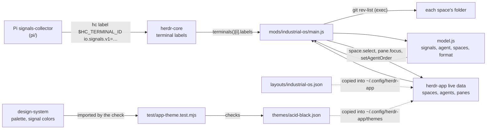

# Architecture

Status: current at the revision that added the Industrial OS sidebar mod.
Evidence: the mod and layout, their tests, and Herdr app 0.1.15's own documentation in `~/.config/herdr-app` (`AGENTS.md` "Layouts" and "Mods", `herdr.d.ts`, `gpui-kit.d.ts`) and its shipped `main` layout and `agents` and `spaces` mods.

## Files and dependencies

| File | Owns | Depends on |
| --- | --- | --- |
| `mods/industrial-os/main.js` | The sidebar view: reads Herdr's live data, keeps the remembered state in `localStorage`, looks up ahead/behind with `git`, runs click commands and draws | The app's `gpui-kit`, `gpui-base` and `herdr` modules; the pure modules beside it |
| `mods/industrial-os/model.js` | The whole sidebar as plain data: which agents get a block, the order, the spaces rows, the next memory and the next time shown text changes | `agent.js`, `signals.js`, `spaces.js` |
| `mods/industrial-os/signals.js` | Reading and validating the `io.signals.v1` label; the stale-label rule | Nothing; the frozen label contract |
| `mods/industrial-os/agent.js` | State precedence, the unseen-work-finished rule, access decay, the pane name and every agent row | `format.js` |
| `mods/industrial-os/spaces.js` | Space state, counts, units, activity and quiet ages, ahead/behind parsing and a space's place | `format.js`, `agent.js` icons |
| `mods/industrial-os/format.js` | Text formats: durations, counts, model, directory, context bar, days, cleaning | Nothing |
| `mods/industrial-os/mod.json` | `"place": "none"`: the mod appears only where a layout puts it | herdr-app's mod format |
| `layouts/industrial-os.json` | The shipped `main` layout with the sidebar's lists replaced by the one `industrial-os` block, and Lunalee's column (`lunalee`: a 1 px `lunalee-host` block for the `lunalee` mod and a `lunalee-chat` block for the terminal of that name) added on the right | herdr-app's layout format; Herdr app 0.1.15's `main.json`; Lunalee's install for the column's mod and terminal |
| `mods/package.json` | Marks the mods' `.js` files as ES modules for Node; not part of the mod | Node 22 |
| `mods/.gitignore` | Keeps out the `gpui-kit.d.ts` and `jsconfig.json` that `herdr-app check` writes into a mod folder for editors | Git |
| `themes/acid-black.json` | The Herdr desktop app's theme: terminal and panel colors | herdr-app's theme file format (`~/.config/herdr-app/AGENTS.md`, "The look"); design-system colors, including `HERDR_TERMINAL` |
| `test/industrial-os.test.mjs` | The pure modules on fixtures: every state, unknowns, caps, decay, the finished rule, space aggregation | The mod's pure modules |
| `test/industrial-os-layout.test.mjs` | The layout differs from the recorded shipped `main.json` only in that block and the frozen Lunalee column; mod.json; imports stay in the mod folder | `test/fixtures/herdr-app-0.1.15-main.json` |
| `test/app-theme.test.mjs` | Each desktop theme color holds its approved design-system value | `foundation/palette` and `/signal-colors` (`SIGNAL_COLORS`, `HERDR_TERMINAL`) by package name |

No code is shared with another project. The mod's imports resolve inside its folder, as herdr-app requires, and the pure modules import neither `gpui-kit` nor `herdr`, so Node's test runner loads them directly. The label is the only data contract with Pi: the signals-collector publishes it; this project only reads it.

## Flow

herdr-app redraws the mod whenever its live data changes: spaces, agents, terminals (including their labels), focus and theme. Each render reads those lists once, passes them with the clock, this computer's home folder, the last ahead/behind results and the remembered state to `buildSidebar`, saves the new memory when it changed, sets the agent order and draws. `buildSidebar`:

1. Parses the label on every live terminal whose agent status `app` is `pi` (from `agents()`, else the core's report). Anything else is no signals.
2. Builds one Pi block per agent with signals and one line per other agent, in `agents()` order, updating each terminal's remembered counts, finished time and last access.
3. Builds one row per space from its panes, using the Pi blocks' states (SUB/RUN as working) and units, and updates its remembered activity.
4. Returns the earliest time any shown clock, decay stage or quiet age will change.

A one-second data timer compares the clock with that time and redraws only then; it also starts ahead/behind lookups: a place (machine and folder) not looked at yet at once, others every 30 seconds while the window is active, one pass at a time with a 5-second timeout per `git` run. A failed run keeps what was shown.

## Critical invariants

| Must remain true | Check |
| --- | --- |
| Unknown is never zero: a missing, malformed or stale label shows `??`, `--%` or nothing, and is no completion | `test/industrial-os.test.mjs` |
| A label counts only on a live terminal whose agent `app` is `pi`, with `version` 1 | `test/industrial-os.test.mjs` |
| State precedence `QNS` > `BLK` > `WRK` > `SUB` > `RUN` > `DNE` > `IDL`/`UNK` | `test/industrial-os.test.mjs` |
| The layout is shipped `main` with only the sidebar lists replaced and the frozen `lunalee` column (ids `lunalee`, `lunalee-host`, `lunalee-chat`; terminal `lunalee-chat`; 580 px, 420–900) as `root`'s third child | `test/industrial-os-layout.test.mjs` |
| The mod imports only `gpui-kit`, `gpui-base`, `herdr` (in `main.js`) and its own files; no `setTimeout`, `Intl`, `TextDecoder` or `WebSocket` | `test/industrial-os-layout.test.mjs` |
| The mod loads and renders in herdr-app | `herdr-app check mods/industrial-os` |
| Every desktop theme color is its approved design-system value | `test/app-theme.test.mjs` |

## Where the next change belongs

- A rule about what a value means: the pure module that owns it, with its test, then [the design](design.md#sidebar).
- How the sidebar looks: `main.js` alone, once the visual design is decided. Visual components come from the design system; a herdr-app mod cannot import outside its folder, so how its elements reach the mod is part of that decision.
- Another Herdr desktop mod or layout: its own folder under `mods/` or file under `layouts/`, with a test beside the others and an install section in the README.

## Limits and evolution

- `herdr-app check` loads the mod with empty in-memory state and renders once; it does not lay out, run timers, later async states or real data. Populated rendering and clicks need the live app.
- Remembered state is per mod copy and per screen. A second copy of the mod (another layout) keeps its own.
- The layout copies Herdr app 0.1.15's `main`; a later `main` is not followed. The layout test records the copy it was made from.
- Lunalee's column names its terminal, so the block is resolved when the layout is built: a terminal started later attaches only after the block is hidden and shown again. When that terminal ends, Herdr deletes the block from the installed copy; re-copying the file restores it. `layout.set` would wipe the layout's `.state` clicks, so nothing here or in Lunalee uses it. Observed live by Lunalee's slice-0 check with herdr-app 0.1.15, not by this project.
- The desktop theme is a herdr-app theme file. Its check proves its values, not that the app accepts it: herdr-app validates on load and writes `settings.error` or a layout's `.error` when it rejects one, so a live install is checked with `herdr-app status`.
