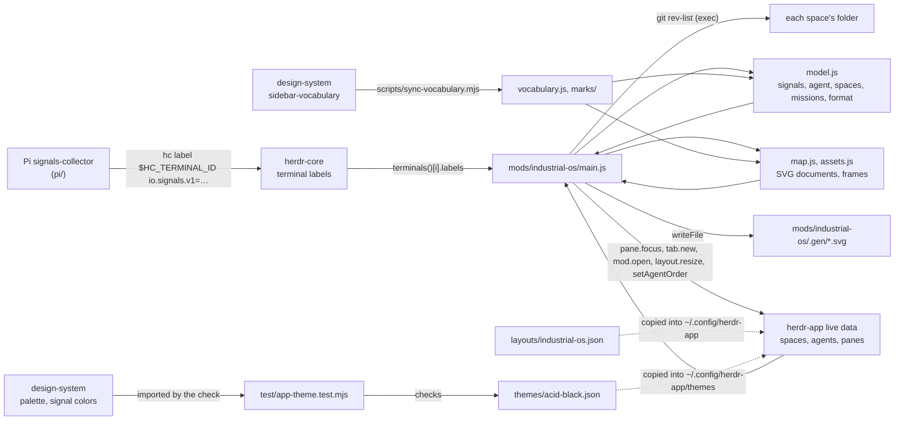
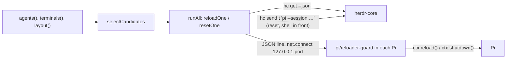

# Architecture

Status: current at Pi Reloader contract version 2, with the sidebar redesign of 2026-11-18, its split into parts with a storybook, and the droid-plate pane header and the Pi Reloader folded into the one `industrial-os` mod ([decision](../../docs/decisions/herdr-combined-mod.md)).
Evidence: the mods and layout, their tests, the redesign's [probe-window record](../CONTRIBUTING.md#sidebar-redesign), and Herdr app 0.1.15's own documentation in `~/.config/herdr-app` (`AGENTS.md` "Layouts", "Keys", "Commands" and "Mods", `herdr.d.ts`, `gpui-kit.d.ts`, whose `net` module offers only `connect(host, port)`), `herdr-app commands`, herdr-core 0.1.20's `hc --help` and `hc --skill`, its shipped `main` layout and `agents`, `spaces`, `confirm` and `picker` mods.

## Files and dependencies

| File | Owns | Depends on |
| --- | --- | --- |
| `mods/industrial-os/main.js` | The mod's root view, and which piece a copy is, chosen by `props().part`. The sidebar's three blocks (`top`, the list, `bottom`) and their rail forms: reads Herdr's live data, keeps the remembered state in `localStorage`, looks up ahead/behind with `git`, runs click and key commands, and places the parts. `part: "storybook"` shows the storybook instead, and the `storybook` command opens it as a window. For `part: "plate"` and `"reloader"` it makes that piece's view and only hands it `init`, `render` and Herdr's `close` | The app's `gpui-kit`, `gpui-base` and `herdr` modules; the pure modules beside it; `parts/`; `storybook.js`; `plate/view.js`; `reloader/view.js` |
| `mods/industrial-os/parts/*.js` | One piece of the sidebar each, drawn from what it is given: the crate plate, a space's band, a pane's rows, ACTION REQUIRED, the scanner, the key plate and the rest ([the list](parts.md#the-parts)). `MapView`, `GroundView` and `ReadoutView` are nested views with their own clocks. `sheet.js` holds the shared measures and `partId`; `stage.js` what a root view shares with its nested views | The app's `gpui-kit` and `gpui-base`; `herdr` in four files, for fonts, the app's folder, `checking()` and `theme()`; the pure modules; each other. Never `main.js`, the storybook or the sample |
| `mods/industrial-os/parts/drawings.js` | The queue of SVG drawings a part asks for by key, and `flush`, the mod's only writer, into `.gen/` | The app's `herdr` and `fs/promises` |
| `mods/industrial-os/storybook.js`, `stories.js` | The storybook: a header, an index and one page per part, each state of it drawn alone on invented data; the stories and what each state shows | The app's modules; `parts/`; `sample.js`; `model.js`, `map.js`, `format.js` |
| `mods/industrial-os/sample.js` | An invented window in the shapes Herdr gives (spaces, agents, terminals, panes, labels): five spaces, nine panes, every state | Nothing |
| `mods/industrial-os/model.js` | The whole sidebar as plain data: agent blocks, space rows, the missions, ACTION REQUIRED, the agents view, the rail's lamps, the counts, the agent order, the next memory and the next time shown text changes | `agent.js`, `signals.js`, `spaces.js`, `missions.js` |
| `mods/industrial-os/missions.js` | Every pane as a unit under its space and tab: designation, state mark, name, age, readings and detail lines; ACTION REQUIRED's order, the agents view's groups, the rail's lamps | `format.js`, `agent.js` icons, `vocabulary.js` |
| `mods/industrial-os/map.js` | The shared map: the world for a set of missions, where each unit is at a time, each window's camera, and one frame as still drawings (SVG documents named by key) plus dots | `vocabulary.js` |
| `mods/industrial-os/assets.js` | The still drawings under and over the text, as SVG documents: halos, bar glows, dot grids, the scanner's corners, the ground, fades, the ruler, sideways text | `vocabulary.js` |
| `mods/industrial-os/fold.js` | The fold's motion as plain data: when each step starts, how each row is erased or typed in, the scan line's pieces | Nothing |
| `mods/industrial-os/vocabulary.js`, `marks/*.svg` | Committed copies of the design system's sidebar vocabulary and its drawn marks. Never edited | `scripts/sync-vocabulary.mjs` writes them |
| `scripts/sync-vocabulary.mjs` | Writes those copies from the design system | `@industrial-os/design-system/foundation/sidebar-vocabulary` by package name |
| `mods/industrial-os/.gen/` | Drawings written at run time, named by content. Not in the repository; emptied by the mod at start past 1500 files | `parts/drawings.js` |
| `mods/industrial-os/signals.js` | Reading and validating the `io.signals.v1` label; the stale-label rule | Nothing; the frozen label contract |
| `mods/industrial-os/agent.js` | State precedence, the unseen-work-finished rule, the pane name and every agent row | `format.js` |
| `mods/industrial-os/spaces.js` | Space state, counts, units, activity and quiet ages, ahead/behind parsing and a space's place | `format.js`, `agent.js` icons |
| `mods/industrial-os/format.js` | Text formats: durations, ages, counts, model, directory, context bar, days, wrapping, cleaning | Nothing |
| `mods/industrial-os/mod.json` | `"place": "none"`: the mod appears only where a layout puts it. Its one overlay is the Pi Reloader's window (`kind: "window"`, 620 × 460, `props.part: "reloader"`), which `mod.open:industrial-os` opens; a test copy adds `overlay.props.only`, the addresses it may act on | herdr-app's mod format |
| `mods/industrial-os/plate/view.js` | The pane header view (`part: "plate"`), one copy per pane: reads its pane, terminal and label, asks `labels.js` for its terminal's `io.droid-plate.v1`, looks up the foreground command and columns with one `hc get` per program change, keeps the remembered times and the motion timeline, composes headers and frames in a task (never in render), runs the pane commands and draws the lighting layers (with their native transitions) and the reveal's rows | The app's `gpui-kit`, `gpui-base` and `herdr` modules; the pure modules beside it |
| `mods/industrial-os/plate/model.js` | The unit and its identity, the strip's segments for every state, the lighting rule, the remembered times (`observe`), formats, the pre-session plate | `ds/` (unit-plate's `sessionUnit`, status-strip's `hintSegments`) |
| `mods/industrial-os/plate/signals.js` | Reading the `io.signals.v1` label for the plate's fields (session ID, working, phase with tool and target, question, settle time); the stale-label rule; the `io.droid-plate.v1` label name | Nothing; the frozen label contract |
| `mods/industrial-os/plate/plate.js` | The header's seven rows at a width and lighting, the unit code fitted, at most 256 columns composed and the rest widened; the peak's first column right of Herdr's grip (`peakFromOf`); the cell width from the measured advance and Herdr's columns; the rows as pieces placed on the cell grid (backgrounds, shape rectangles, the peak's triangles in device-pixel bands, one text piece per text cell), each tagged with its row and lighting bank, the bank boxes, the bay keys' hit areas, and the piece budget (`coarsen`) | `ds/` (unit-plate, status-strip, cells, glyph-shapes) |
| `mods/industrial-os/plate/motion.js` | The motion timeline: which motions a change starts (T2 and H1 as lighting layers with their banks' delays, the reveal's outgoing plate, boot, K5, latch, K4 and its seeded schedule, deferred past other motions), priming and settling, when each ends, the frame timer's step, the next wake, and each layer's character-motion frame | `ds/` motions (bank-switch's `bankSchedule`, crt-boot, serial-roll, reveal's duration, latch, ghost), pixel-numeral, seeded |
| `mods/industrial-os/plate/labels.js` | `LabelPublisher`: the wanted terminal kept apart from the acknowledged and maybe-labelled ones, one serialized writer of bounded `hc label` calls, retries with a bound, `close()` superseding every pending write | `signals.js` (the label name) |
| `mods/industrial-os/plate/clock.js` | `Scheduler`: the frame timer (only while a character-level motion plays, at its step) and one wake, never re-armed for a deadline that has fired | Nothing; the view injects `cx.timer` |
| `mods/industrial-os/ds/` | A byte-for-byte copy of exactly the design-system files the mod's modules import (today the pane header's), in the design system's own tree, because a mod folder is copied into the app as it is | `design-system/`, through `scripts/sync-design-system.mjs` |
| `mods/industrial-os/plate/mark.svg` | The `⟁` mark drawn over its cell | herdr-app's `svg` |
| `scripts/sync-design-system.mjs` | Regenerates every mod's `ds/` from the import closure of its `./ds/…` imports; `--check` lists missing, extra and changed files | Node's standard library |
| `layouts/industrial-os.json` | The shipped `main` layout with zero terminal padding, flat panes (radius 0, no border or focus outline) under the 130 px pane header (`industrial-os`, `part: "plate"`), the sidebar at 300 px and its `brand` header (130 px, `part: "top"`), lists and `sidebar-footer` (46 px, `part: "bottom"`) replaced by `industrial-os` blocks, and Lunalee's column (`lunalee`: a 1 px `lunalee-host` block for the `lunalee` mod and a `lunalee-chat` block for the terminal of that name) added on the right | herdr-app's layout format; Herdr app 0.1.15's `main.json`; Lunalee's install for the column's mod and terminal |
| `mods/industrial-os/reloader/view.js` | The Pi Reloader window (`part: "reloader"`): answers the `reloader-reload`, `reloader-reset` and `reloader-close` commands, lists candidates, runs an action in one task, and supplies its `io`: `hc get` and `hc send`, and the guard's loopback socket through `net` | The app's `gpui-kit`, `gpui-base`, `herdr` and `net` modules; `reloader.js` |
| `mods/industrial-os/reloader/reloader.js` | Every Pi Reloader rule: candidates and protection, the guard label and wire checks, the reload and reset sequences, the summary | Nothing; the [guard contract](../../pi/reloader-guard/docs/contract.md) |
| `mods/industrial-os/reloader/LICENSE` | MIT, for the Pi Reloader's two files, keeping the notice of the code they were adapted from | Nothing |
| `keys/pi-reloader.json` | The keys.json snippet a person merges: `cmd-alt-r` → `mod.open:industrial-os` | herdr-app's keys format |
| `mods/package.json` | Marks the mods' `.js` files as ES modules for Node; not part of the mod | Node 22 |
| `mods/.gitignore` | Keeps out the `gpui-kit.d.ts` and `jsconfig.json` that `herdr-app check` writes for editors into a mod folder, and the `gpui-kit.d.ts` it writes into each folder inside one whose files import `gpui-kit` | Git |
| `themes/acid-black.json` | The Herdr desktop app's theme: terminal and panel colors | herdr-app's theme file format (`~/.config/herdr-app/AGENTS.md`, "The look"); design-system colors, including `HERDR_TERMINAL` |
| `test/industrial-os.test.mjs` | The pure modules on fixtures: every state, unknowns, caps, the finished rule, space aggregation, missions and units, ACTION REQUIRED, the agents view, the rail's lamps, ages and wrapping | The mod's pure modules |
| `test/industrial-os-sidebar.test.mjs` | The copies equal the design system's vocabulary and marks; the map's world, units, cameras and frames; every drawing is a well-formed SVG | The mod's pure modules; the design-system package by name; `scripts/sync-vocabulary.mjs` |
| `test/industrial-os-layout.test.mjs` | The layout differs from the recorded shipped `main.json` only in the listed changes and the frozen Lunalee column; mod.json (the Pi Reloader's window, with no `only`); every import and re-export stays in the mod folder, only the files that draw import the app, only `parts/drawings.js` imports `fs/promises` and only `reloader/view.js` `net`, only pure modules reach `ds/`, no part imports `main.js`, the storybook, the sample, `plate/` or `reloader/`, and those two take only `parts/drawings.js` from outside their folders | `test/fixtures/herdr-app-0.1.15-main.json` |
| `test/industrial-os-parts.test.mjs` | Every part has a story; every story draws each of its states over time with no element id used twice, and the page turns from the keys; a story keeps only its own clocks and a settled readout rests; drawings are written where the folder cannot be listed and never during a check; `partId` and `scoped`; the sidebar's three blocks draw the sample window and the `storybook` command opens one window | `stand-in/`; the mod's drawing code |
| `test/industrial-os-root.test.mjs` | One mod is every piece: the root view is the pane header for `part: "plate"` (it draws, labels its terminal, and Herdr's close clears the label) and the Pi Reloader for `part: "reloader"`, which starts only on its own commands while the sidebar's blocks hear the same ones | `stand-in/`; the mod's drawing code |
| `stand-in/` | What Node loads in place of the app's modules: `kit.mjs` and `base.mjs` (an element builder that records and throws on an unknown method), `herdr.mjs` (a window a test sets; what the mod asked for; an `hc` that always fails), `fs.mjs` (in memory; a test can make listing fail as the app does), `net.mjs` (opens no socket), `hooks.mjs` (maps the imports) and `sim.mjs` (views on a clock a test moves; the drawn tree as data) | Node's standard library |
| `test/pi-reloader.test.mjs` | The Pi Reloader's rules against a simulated herdr-core and guard; its folder's files and that they hold no color value | `mods/industrial-os/reloader/` |
| `test/droid-plate.test.mjs` | The pane header's rules: units, strips, lighting, the label, the rows at 24–200 columns, the keys, the motion timeline; its folder's files and imports; `ds/` equal to the design system's closure | `mods/industrial-os/plate/`, `mods/industrial-os/ds/`, `scripts/sync-design-system.mjs` |
| `test/app-theme.test.mjs` | Each desktop theme color holds its approved design-system value | `foundation/palette` and `/signal-colors` (`SIGNAL_COLORS`, `HERDR_TERMINAL`) by package name |

No code is shared with another project at run time, except the mod's `ds/` copy of design-system files, which the pane header draws with (see [droid-plate](#droid-plate)); the sidebar's vocabulary is a committed copy of values. The mod's imports resolve inside its folder, as herdr-app requires, and the pure modules import neither `gpui-kit` nor `herdr`, so Node's test runner loads them directly. The label is the only data contract with Pi: the signals-collector publishes it; this project only reads it.

## Flow

herdr-app redraws each of the mod's three blocks whenever its live data changes: spaces, agents, panes, terminals (including their labels), focus and theme. Each block is its own copy of the view. Each render reads those lists once and passes them with the clock, this computer's home folder, the last ahead/behind results, the remembered state, the folded spaces, the focused pane and the shown view to `buildSidebar`. Only the list block saves the new memory, sets the agent order and looks up `git`; the top block reads the same data for its counts and map and keeps nothing. `buildSidebar`:

1. Parses the label on every live terminal whose agent status `app` is `pi` (from `agents()`, else the core's report). Anything else is no signals.
2. Builds one Pi block per agent with signals and one line per other agent, in `agents()` order, updating each terminal's remembered counts and finished time.
3. Builds one row per space from its panes, using the Pi blocks' states (SUB/RUN as working) and units, and updates its remembered activity.
4. Builds the missions from every pane, with the blocks' states and readings, then ACTION REQUIRED, the agents view, the rail's lamps and the counts.
5. Returns the earliest time any shown clock, age or quiet age will change.

**Drawings.** A render asks for each drawing by a key (`picture(key, make, …)`). The first time, the key is queued and its place stays empty; the block's clock writes queued drawings to `.gen/` as SVG files named by their content, and the next render places them. Each block has its own queue. **The map** is a `MapView` per open space, and one in the plate, created and released by the block's clock, never during a render. Each has a 33 ms clock of its own and reads its block's shared `stage` (the world, the hovered unit, the watched unit), so the map moves without redrawing the list. **Two more nested views** read the same stage, both made once when the list block starts: `GroundView` draws [the ground's light](design.md#ground) on the same 33 ms clock from the pointer's place, which the list's `on_mouse_move` only records; `ReadoutView` draws the scanner's readout and is redrawn by a 30 ms timer that the list starts when the pointer reaches a pane and cancels 1.2 s later. **Between blocks** there are two channels, both `shared()` keys. `industrial-os.aim`: the list sets it to the ACTION REQUIRED unit under the pointer and the plate's crosshair follows. `industrial-os.motion`: `{ at, kind, step }` of a [fold in motion](design.md#folding-and-unfolding); the block that was asked sets each step from timers and every block draws its own covers for it. **Herdr's own mods** are opened by name, never imported: `picker` from the search hint, `menu` (as a popup, with a tab as its target) from a right click on a tab title. One older than 3 s is ignored, so a mod reloaded mid-fold leaves nothing behind. **The scanner** is one element per list. In the scrolling list its place is measured, not computed: a pane's `on_mouse_move` bounds against the list body's, taken from the same pointer move.

One 110 ms clock per block writes drawings, steps the state marks while a moving one is shown (and the open grip's chevrons), and every ninth tick compares the clock with that time and redraws only then; it also starts ahead/behind lookups: a place (machine and folder) not looked at yet at once, others every 30 seconds while the window is active, one pass at a time with a 5-second timeout per `git` run. A failed run keeps what was shown.

## Droid-plate

The layout's pane frame names `industrial-os` with `props: { "part": "plate" }` as its header, so the app keeps one copy of the mod per pane of the shown tab with `props().pane` and `props().terminal` (`~/.config/herdr-app/AGENTS.md`, "Pane frames"). Each copy:

1. **Reads** in render: its `PaneInfo` from `panes()` (app, program, status, focused, zoomed, folder, branch, title), its terminal from `terminals()` (argv, columns, labels), the `io.signals.v1` label when the app is `pi` and the terminal is live, and `window().active`, which `herdr.d.ts` documents as live. A 500 ms timer redraws when the window's answer changed since the last draw, in case activation does not redraw a pane header; it does nothing otherwise, and stops in a copy that is not shown (two asked-for redraws that never came) until it renders again.
2. **Remembers** per copy: when Pi was first seen (STARTING's 3 s), when it handed back (PI EXITED until the next command), when the foreground program and an agent's work started, the motion timeline, and composed headers (at most 48, keyed by their inputs).
3. **Looks up** the foreground command with `hc get <terminal> --json` (herdr's `hc`), once per change of program or title, one at a time, bounded at 2 s; its `foreground.argv` is the RUNNING text and its `cols` the width until `terminals()` reports one. A failure keeps the program's name.
4. **Composes in a task.** herdr-app's QuickJS runtime interrupts a render after about 50 ms (measured with `herdr-app check`: 50 ms passed, 60 ms failed; tasks and `init` ran to about 500 ms), and a 99-column plate takes about 15–30 ms there. So render only reads and compares what it should show with what it last asked for; on a change it starts one task that composes the needed headers (`plate.js`), advances the timeline (`motion.js`) and turns each lighting layer's frame into pieces (cached per composed header). Render draws the pieces that task left, so a change shows one task turn late. A lighting change (T2, H1) is a new layer drawn in four bank boxes at opacity 0 and, 20 ms later, at 1 with each bank's delayed `.transition("opacity")`; the reveal draws the outgoing plate's rows as right-anchored clips whose `.transition("width")` takes them to 0. Herdr animates both natively. Only the character-level motions (CRT boot, K5, latch, K4) compose frames on a timer, at 40 or 50 ms, and only while one plays (about 25 ms a frame at 198 columns in `herdr-app check`); one wake (`clock.js`) brings the copy back for the next clock second, STARTING's end, the next K4 ghost, priming and settling. A timer that has asked twice for a redraw that never came (the copy is not shown) stops, and the next render restarts what is due.
5. **Measures the grid.** The header's width comes from its own layout (`on_size_change`), and the terminal font's advance from a transparent 16-character probe in that font at the terminal's size. Herdr places terminal cells as Ghostty does, the advance times `terminal_cell_width` rounded up to a whole device pixel, and a mod is not told the display's scale, so `cellWidthOf` takes the scale (2, 1, 3, 4) whose cell gives Herdr's column count across the header: measured live at 2x, JetBrains Mono 14's 8.406 px advance is the 8.5 px cell, 198 columns in 1684 px. The plate is then `floor(width ÷ cell)` columns, and the part of a cell left over at the right takes each row's last color. Until both are laid out it uses the terminal's columns and `font_size × 0.6`. At most 256 of those columns are composed (`DRAW_LIMIT`); a wider header's plan widens the drawn rows from 19 cells before their right edge, repeating the plain ground there, and the motions run on the drawn rows, so a wide pane costs what a 256-column one does. One render draws at most 2,400 pieces (`PIECE_BUDGET`), shared by the lighting layers and the reveal on screen: a plan over its share joins its ground and hairline runs across colors at most 2, 4, 8 or 16 apart per channel (`coarsen`), inks, the peak, the strip and the bay untouched. A single plate never needs it; during a switch the layers do (measured in `herdr-app check`: a two-layer switch at 256 columns composes in about 250 ms and draws in 8–15 ms, a 198-column one drew in 32–34 ms before the budget was shared).
6. **Draws** every piece absolutely, at x = col × cell (snapped to the device pixel) and the row's top (rows of 18.5 px and a 19 px strip), never as flowing text, whose glyph advance (8.406 px) is not the cell (8.5 px): background rectangles, adjacent cells of one color merged; the glyphs a terminal draws as shapes, from the design system's `GLYPH_SHAPES` (block elements, so the barcode's bars and the wordmark's pixels fill their cells and join across rows; light lines; the peak's Powerline triangles, as one-device-pixel bands, since herdr-app's `svg` keeps its aspect ratio and cannot stretch a triangle to a cell); and one text element per text cell, a cell wide and centred, in the terminal's font (`font_family`, Herdr's JetBrains Mono by default). Nothing depends on a font the app may lack: text is ASCII, `®`, `■ ● ○ ▶ ▲` and `…`, which JetBrains Mono has, and `⟁` is `mark.svg`. The bay's keys are their own elements with the key's hit cells, hover and press, running `pane.split {direction}`, `pane.zoom` and `pane.close` with the pane, as the shipped `pane` header does; a click elsewhere runs `pane.focus`.
7. **Labels its terminal** `io.droid-plate.v1=1` when it first draws for that terminal and moves the label when the terminal changes, through `labels.js`: what the copy wants is kept apart from what `hc` acknowledged, one worker sends the writes one at a time (each bounded at 2 s, a terminal's next write waiting for its earlier one), so a set and a clear never land out of order; a terminal no longer wanted is cleared before the new one is set; a failed write is retried after 250, 500 and 1000 ms, then left until what is wanted changes. `close()`, which the app calls when the pane, tab or layout-owned slot goes and on quit (at most 250 ms), supersedes every pending write and clears every terminal that may carry the label, after a write in flight has landed (at most 100 ms). The [droid header](../../pi/droid-header/docs/architecture.md#flow) reads it once at Pi's session start to show its ledger alone. Not called for a hidden copy or an inactive tab, whose plate still exists, so its label stays.

Colors in the drawn rows are design-system values carried by the composed lines (resolved to hex by `ds/foundation/cells.mjs`), not `theme()` names: the plate is the design system's, as it is in the terminal.

`ds/` holds exactly the design-system modules the pure modules import and everything they import (21 files), byte for byte; `node herdr/scripts/sync-design-system.mjs` rewrites it and `test/droid-plate.test.mjs` fails while it differs. The design system's text functions use `Intl.Segmenter` when the host has it and code points otherwise: the mod runtime has no `Intl`.

## Pi Reloader

`mod.open:industrial-os` opens the mod's `mod.json` overlay as a window, with `part: "reloader"` in its props, so the root view is the Pi Reloader; it needs no layout. Its commands carry the piece's name (`industrial-os.reloader-reload`, `-reset`, `-close`), because every copy of the mod on screen hears every command. As a window, a press it doesn't stop doesn't close it, and Esc reaches the mod, which ignores keys while a run is going. A run is one `cx.spawn` task; `reloader.js` gets an `io` whose every call goes through herdr-core or the guard, so the whole sequence is tested with a simulated one.

1. **Select.** From `agents()`: Pi (`app` is `pi`) on this computer, in a pane, not shown by a layout block nor named `lunalee-chat`, idle or done. Other Pi agents are counted as busy or protected; other agents are ignored. A window's `only` prop narrows the set.
2. **Run.** Both actions start on every candidate at once and wait for every attempt; each ends completed, skipped with a reason, or failed with a reason.
3. **Check at action time.** `hc get <t> --json` must show it live, Pi's status idle or done, and a valid `io.pi-reloader.v2` label; else skip, or fail without a guard, with nothing done.
4. **Reload:** probe; if ready, `reload` with the probed session; then poll `hc get` until the label shows a new token and a probe on it answers (30 s).
5. **Reset:** the root program must be sh, bash, zsh, dash or ksh with Pi as a job; probe; a session file is required; `quit`; poll until the shell is in front with no agent status (15 s); `hc send` the single-quoted resume line; poll until Pi reports idle or done with a new label and a probe returns the same session (30 s).

Neither action moves focus or marks anything read. Neither advances herdr-core's per-terminal `turn`, so Herdr's idle or done for each Pi stays as it was; see [the decision](../../docs/decisions/pi-reloader-desktop.md). The polls run only while the mod acts: `hc wait` waits for an agent to stop working, and these Pis are already settled.

Commands from `nextCommand()` (`reloader-reload`, `reloader-reset`, `reloader-close`) reach the window only while it is open; it ignores every other command of the mod.

## Critical invariants

| Must remain true | Check |
| --- | --- |
| Unknown is never zero: a missing, malformed or stale label shows `??`, `--%` or nothing, and is no completion | `test/industrial-os.test.mjs` |
| A label counts only on a live terminal whose agent `app` is `pi`, with `version` 1 | `test/industrial-os.test.mjs` |
| State precedence `QNS` > `BLK` > `WRK` > `SUB` > `RUN` > `DNE` > `IDL`/`UNK` | `test/industrial-os.test.mjs` |
| The layout is shipped `main` with only zero terminal padding, flat panes, the 130 px pane header (`part: "plate"`), the sidebar at 300 px, its header, lists and footer replaced, and the frozen `lunalee` column (ids `lunalee`, `lunalee-host`, `lunalee-chat`; terminal `lunalee-chat`; 580 px, 420–900) as `root`'s third child | `test/industrial-os-layout.test.mjs` |
| The mod imports only `gpui-kit`, `gpui-base` and `herdr` (in `main.js`, `storybook.js`, `stories.js`, `parts/`, `plate/view.js` and `reloader/view.js`), `fs/promises` (in `parts/drawings.js`), `net` (in `reloader/view.js`) and its own files, `ds/` only from pure modules; no `setTimeout`, `Intl`, `TextDecoder`, `WebSocket` or `import()` | `test/industrial-os-layout.test.mjs` |
| A copy of the mod is one piece: the pane header and the Pi Reloader get Herdr's `close`, and the Pi Reloader starts only on `reloader-…` commands | `test/industrial-os-root.test.mjs` |
| A part imports no `main.js`, storybook or sample; every part has a story, and every story draws with no element id used twice | `test/industrial-os-layout.test.mjs`, `test/industrial-os-parts.test.mjs` |
| The storybook reads no space, pane, agent or terminal from Herdr (only the theme, the fonts, its props and its page-turning commands), and its stories' handlers do nothing | Review of `storybook.js` and `stories.js` |
| `vocabulary.js` and `marks/` equal the design system's sidebar vocabulary | `test/industrial-os-sidebar.test.mjs` |
| A drawing's key names one document: the same key always writes the same SVG, and every document is well formed | `test/industrial-os-sidebar.test.mjs` |
| The mod writes only inside its own `.gen/` folder | `test/industrial-os-layout.test.mjs` (one file imports `fs/promises`); review `parts/drawings.js`: `flush` is the only writer |
| The mod loads and renders in herdr-app | `herdr-app check mods/industrial-os` |
| The pane header is one view and six pure modules, which import only each other and `ds/` | `test/droid-plate.test.mjs` |
| `mods/industrial-os/ds/` is byte for byte the design system's files, exactly the import closure | `test/droid-plate.test.mjs`, `node herdr/scripts/sync-design-system.mjs --check` |
| A pane plate shows only what the mod can read; unknown degrades to `DRD-????`, `AGT` or `TERM` and a missing time is left out | `test/droid-plate.test.mjs` |
| Render never composes a plate; every row is exactly the plate's width | Review of `plate/view.js`; `test/droid-plate.test.mjs` |
| Every plate piece starts on a cell boundary, the rows tile the header's width, and the barcode's last bar and the bay end on W − 3; block elements, lines and the peak are shapes, and every text cell is a glyph JetBrains Mono has | `test/droid-plate.test.mjs`, `node herdr/scripts/check-droid-plate.mjs` |
| The peak starts right of Herdr's grip plus 2 cells and ends three cells before the title block; at most 256 columns are composed, the middle widened so every row tiles the header and the block, barcode and bay end on W − 3 at any width | `test/droid-plate.test.mjs`, `node herdr/scripts/check-droid-plate.mjs` (1200 columns) |
| T2, H1 and the reveal run no timer; a timer runs only while a character-level motion plays, a fired wake is never re-armed and a due ghost waits for the motion playing | `test/droid-plate.test.mjs` (a fake clock on the real `Scheduler`), review of `plate/view.js` |
| Label writes are serialized, bounded and retried with a bound, and `close()` supersedes them | `test/droid-plate.test.mjs` (deferred and rejected `hc`) |
| The pane header draws every state without an error | `node herdr/scripts/check-droid-plate.mjs` (`herdr-app check` on a temporary copy whose root is the plate) |
| Every desktop theme color is its approved design-system value | `test/app-theme.test.mjs` |
| The Pi Reloader never types into Pi, never kills, acts only through a matching guard, skips drafts, busy and protected terminals, and types its one shell line only into the root POSIX shell in front | `test/pi-reloader.test.mjs` |
| The shipped `mod.json` overlay has no `only` prop, so the Pi Reloader acts on every candidate | `test/industrial-os-layout.test.mjs` |
| The mod loads and renders | `herdr-app check mods/industrial-os` (it draws the list block; the pane header and the Pi Reloader only load) |

## Where the next change belongs

- A rule about what a value means: the pure module that owns it, with its test, then [the design](design.md#sidebar).
- A color, opacity, status word, designation or state mark: the design system's `sidebar-vocabulary.mjs` first, then `node scripts/sync-vocabulary.mjs`.
- Something the map shows: `map.js`. A halo, grid or fade: `assets.js`. Both return SVG documents; neither places anything.
- How one piece of the sidebar is drawn: its file in `parts/`, with its contract comment and its story in `stories.js` ([parts](parts.md#adding-or-changing-a-part)). A piece drawn in two places becomes a part before it is drawn a second time.
- Where the parts sit, what the pointer does, which command a click runs: `main.js`.
- What a pane plate shows or when it moves: `mods/industrial-os/plate/model.js` or `motion.js` and their test, then [the design](design.md#pane-plate); how it looks: the design system first, then `ds/` regenerated.
- Another piece of Industrial OS in the app (a header, a window, a block): a folder inside `mods/industrial-os/` with a `view.js` and its pure modules, a `part` in `main.js`'s `WHOLE`, and the folder's name in the layout test's `FOLDERS`; not a mod of its own, which could share no file with this one ([decision](../../docs/decisions/herdr-combined-mod.md)). The mod has one `mod.json` window, the Pi Reloader's; any other window is opened by the mod with `openOverlay`, as the storybook is. A layout is a file under `layouts/`, with a test beside the others and an install section in the README. A keys.json snippet goes in `keys/`.
- A Pi Reloader rule: `reloader.js` and its test; a protocol change starts in the [guard contract](../../pi/reloader-guard/docs/contract.md).

## Limits and evolution

- `herdr-app check` loads a mod with empty in-memory state and renders once, as the list block (its props name no part), so the pane header and the Pi Reloader are loaded but not drawn; it does not lay out, run timers, later async states or real data. The stand-in builds populated trees and runs timers and handlers in Node, but paints nothing; a populated look needs the storybook or the sidebar in an [isolated app](../CONTRIBUTING.md#isolated-app), or the live app.
- The storybook's states are set by its stories, not by the pointer: a state "under the pointer" is drawn as if it were. Only the ground's light and each part's own `hover` styles follow the real pointer there.
- herdr-app lets a mod list folders only inside the user's home folder. With an app home outside it (an isolated app in `/tmp`), the mod cannot list `.gen/`, so it rewrites the drawings it needs at each start and never empties the folder.
- The three blocks are separate copies of the view. Whether they share module state is herdr-app's choice, so nothing relies on it: each keeps its own drawings queue and stage, and they talk only through `shared()`.
- Drawings are files: a new text's halo appears a tick after the text. Names are content hashes (FNV-1a and length), so a changed drawing is a new file and the folder only grows; past 1500 files the mod empties it at its next start and rewrites what it needs.
- The map and the marks cost CPU: roughly 16 points of one core for three open spaces and the plate at 30 frames a second (6 to 9 at 20), measured roughly in a probe window ([record](../CONTRIBUTING.md#sidebar-redesign)). They do not stop while another app is in front, by the operator's choice, and the ground's light adds a redraw of its own at the same rate that was not measured. 30 frames a second is the operator's choice over the 20 first shipped.
- Remembered state is per mod copy and per screen. A second copy of the mod (another layout) keeps its own.
- The layout copies Herdr app 0.1.15's `main`; a later `main` is not followed. The layout test records the copy it was made from.
- Lunalee's column names its terminal, so the block is resolved when the layout is built: a terminal started later attaches only after the block is hidden and shown again. When that terminal ends, Herdr deletes the block from the installed copy; re-copying the file restores it. `layout.set` would wipe the layout's `.state` clicks, so nothing here or in Lunalee uses it. Observed live by Lunalee's slice-0 check with herdr-app 0.1.15, not by this project.
- The Pi Reloader's run lives in its window's task: a layout switch closes the window and stops it. So does saving any file of the installed mod, which reloads every copy of it: the sidebar and every pane header start again (a pane's remembered times with them), and a run in progress ends where it was. An install is done with no run going.
- Herdr gives a mod one view class, so `main.js` makes the pane header's or the Pi Reloader's view itself and hands it `init`, `render` and `close`. Seen to work in an isolated app on herdr-app 0.1.16 (timers, tasks, focus and the commands reach the inner view through the root's `cx`); nothing in Herdr's documents promises it.
- The desktop theme is a herdr-app theme file. Its check proves its values, not that the app accepts it: herdr-app validates on load and writes `settings.error` or a layout's `.error` when it rejects one, so a live install is checked with `herdr-app status`.
- The pane header infers the display scale from the advance and Herdr's columns; when no scale matches (an unusual cell-width multiplier or font), the cell is the header's width over the columns, still exact at both edges but up to a fraction of a pixel per column off the terminal's cells. The peak's edges step one device pixel at a time, without antialiasing. The label's clearing on a layout switch was seen in an isolated app, for the shown pane. Its activation fallback and the native T2, H1 and reveal on a real focus or hand-back are unverified live (a probe proved Herdr's delayed per-bank opacity and width transitions; the plate's own were not watched, since the live app could not be focused for it). Over 256 columns the plate's middle is plain widened ground.
