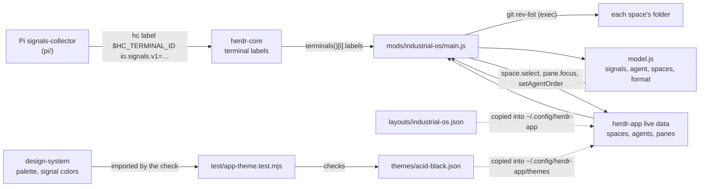
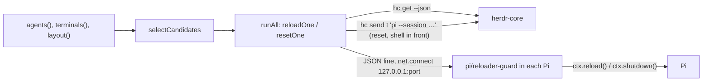

# Architecture

Status: current at Pi Reloader contract version 2, with the droid-plate pane header.
Evidence: the mods and layout, their tests, and Herdr app 0.1.15's own documentation in `~/.config/herdr-app` (`AGENTS.md` "Layouts", "Keys", "Commands" and "Mods", `herdr.d.ts`, `gpui-kit.d.ts`, whose `net` module offers only `connect(host, port)`), `herdr-app commands`, herdr-core 0.1.20's `hc --help` and `hc --skill`, its shipped `main` layout and `agents`, `spaces`, `confirm` and `picker` mods.

## Files and dependencies

| File | Owns | Depends on |
| --- | --- | --- |
| `mods/industrial-os/main.js` | The sidebar view: reads Herdr's live data, keeps the remembered state in `localStorage`, looks up ahead/behind with `git`, runs click commands and draws. With `props.brand` it is the sidebar header instead: no memory, timer or `git`, and the search and sidebar-toggle buttons drawn with the shipped `workspace-chrome` mod's icons | The app's `gpui-kit`, `gpui-base` and `herdr` modules; the pure modules beside it |
| `mods/industrial-os/model.js` | The whole sidebar as plain data: which agents get a block, the order, the spaces rows, the next memory and the next time shown text changes; the header's droid count | `agent.js`, `signals.js`, `spaces.js` |
| `mods/industrial-os/signals.js` | Reading and validating the `io.signals.v1` label; the stale-label rule | Nothing; the frozen label contract |
| `mods/industrial-os/agent.js` | State precedence, the unseen-work-finished rule, access decay, the pane name and every agent row | `format.js` |
| `mods/industrial-os/spaces.js` | Space state, counts, units, activity and quiet ages, ahead/behind parsing and a space's place | `format.js`, `agent.js` icons |
| `mods/industrial-os/format.js` | Text formats: durations, counts, model, directory, context bar, days, cleaning | Nothing |
| `mods/industrial-os/mark.svg` | The header's `⟁` mark, drawn bold in the plate's text color | Nothing |
| `mods/industrial-os/mod.json` | `"place": "none"`: the mod appears only where a layout puts it | herdr-app's mod format |
| `mods/droid-plate/main.js` | The pane header view, one copy per pane: reads its pane, terminal and label, asks `labels.js` for its terminal's `io.droid-plate.v1`, looks up the foreground command and columns with one `hc get` per program change, keeps the remembered times and the motion timeline, composes headers and frames in a task (never in render), runs the pane commands and draws the lighting layers (with their native transitions) and the reveal's rows | The app's `gpui-kit`, `gpui-base` and `herdr` modules; the pure modules beside it |
| `mods/droid-plate/model.js` | The unit and its identity, the strip's segments for every state, the lighting rule, the remembered times (`observe`), formats, the pre-session plate | `ds/` (unit-plate's `sessionUnit`, status-strip's `hintSegments`) |
| `mods/droid-plate/signals.js` | Reading the `io.signals.v1` label for the plate's fields (session ID, working, phase with tool and target, question, settle time); the stale-label rule; the `io.droid-plate.v1` label name | Nothing; the frozen label contract |
| `mods/droid-plate/plate.js` | The header's seven rows at a width and lighting, the unit code fitted, at most 256 columns composed and the rest widened; the peak's first column right of Herdr's grip (`peakFromOf`); the cell width from the measured advance and Herdr's columns; the rows as pieces placed on the cell grid (backgrounds, shape rectangles, the peak's triangles in device-pixel bands, one text piece per text cell), each tagged with its row and lighting bank, the bank boxes, the bay keys' hit areas, and the piece budget (`coarsen`) | `ds/` (unit-plate, status-strip, cells, glyph-shapes) |
| `mods/droid-plate/motion.js` | The motion timeline: which motions a change starts (T2 and H1 as lighting layers with their banks' delays, the reveal's outgoing plate, boot, K5, latch, K4 and its seeded schedule, deferred past other motions), priming and settling, when each ends, the frame timer's step, the next wake, and each layer's character-motion frame | `ds/` motions (bank-switch's `bankSchedule`, crt-boot, serial-roll, reveal's duration, latch, ghost), pixel-numeral, seeded |
| `mods/droid-plate/labels.js` | `LabelPublisher`: the wanted terminal kept apart from the acknowledged and maybe-labelled ones, one serialized writer of bounded `hc label` calls, retries with a bound, `close()` superseding every pending write | `signals.js` (the label name) |
| `mods/droid-plate/clock.js` | `Scheduler`: the frame timer (only while a character-level motion plays, at its step) and one wake, never re-armed for a deadline that has fired | Nothing; the view injects `cx.timer` |
| `mods/droid-plate/ds/` | A byte-for-byte copy of exactly the design-system files the mod's modules import, in the design system's own tree, because a mod folder is copied into the app as it is | `design-system/`, through `scripts/sync-design-system.mjs` |
| `mods/droid-plate/mod.json`, `mark.svg` | `"place": "none"`: only the layout's pane frame puts it on a pane; the `⟁` mark drawn over its cell | herdr-app's mod format |
| `scripts/sync-design-system.mjs` | Regenerates every mod's `ds/` from the import closure of its `./ds/…` imports; `--check` lists missing, extra and changed files | Node's standard library |
| `layouts/industrial-os.json` | The shipped `main` layout with zero terminal padding, flat panes (radius 0, no border or focus outline) under the 130 px `droid-plate` header, the sidebar at 300 px and its `brand` header and lists replaced by `industrial-os` blocks (the header with `props.brand`), and Lunalee's column (`lunalee`: a 1 px `lunalee-host` block for the `lunalee` mod and a `lunalee-chat` block for the terminal of that name) added on the right | herdr-app's layout format; Herdr app 0.1.15's `main.json`; Lunalee's install for the column's mod and terminal |
| `mods/pi-reloader/main.js` | The Pi Reloader window: lists candidates, runs an action in one task, and supplies its `io`: `hc get` and `hc send`, and the guard's loopback socket through `net` | The app's `gpui-kit`, `gpui-base`, `herdr` and `net` modules; `reloader.js` |
| `mods/pi-reloader/reloader.js` | Every Pi Reloader rule: candidates and protection, the guard label and wire checks, the reload and reset sequences, the summary | Nothing; the [guard contract](../../pi/reloader-guard/docs/contract.md) |
| `mods/pi-reloader/mod.json`, `LICENSE` | The window it opens as (`kind: "window"`, 620 × 460; a test copy adds `overlay.props.only`, the addresses it may act on); MIT, keeping the notice of the code it was adapted from | herdr-app's mod format |
| `keys/pi-reloader.json` | The keys.json snippet a person merges: `cmd-alt-r` → `mod.open:pi-reloader` | herdr-app's keys format |
| `mods/package.json` | Marks the mods' `.js` files as ES modules for Node; not part of the mod | Node 22 |
| `mods/.gitignore` | Keeps out the `gpui-kit.d.ts` and `jsconfig.json` that `herdr-app check` writes into a mod folder for editors | Git |
| `themes/acid-black.json` | The Herdr desktop app's theme: terminal and panel colors | herdr-app's theme file format (`~/.config/herdr-app/AGENTS.md`, "The look"); design-system colors, including `HERDR_TERMINAL` |
| `test/industrial-os.test.mjs` | The pure modules on fixtures: every state, unknowns, caps, decay, the finished rule, space aggregation | The mod's pure modules |
| `test/industrial-os-layout.test.mjs` | The layout differs from the recorded shipped `main.json` only in that block and the frozen Lunalee column; mod.json; imports stay in the mod folder | `test/fixtures/herdr-app-0.1.15-main.json` |
| `test/pi-reloader.test.mjs` | The Pi Reloader's rules against a simulated herdr-core and guard; its folder's imports, globals and the shipped `mod.json` | `mods/pi-reloader/` |
| `test/droid-plate.test.mjs` | The pane header's rules: units, strips, lighting, the label, the rows at 24–200 columns, the keys, the motion timeline; its imports and globals; `ds/` equal to the design system's closure | `mods/droid-plate/`, `scripts/sync-design-system.mjs` |
| `test/app-theme.test.mjs` | Each desktop theme color holds its approved design-system value | `foundation/palette` and `/signal-colors` (`SIGNAL_COLORS`, `HERDR_TERMINAL`) by package name |

No code is shared with another project, except the droid-plate mod's `ds/` copy of design-system files (see [droid-plate](#droid-plate)). The mods' imports resolve inside their folders, as herdr-app requires, and the pure modules import neither `gpui-kit` nor `herdr`, so Node's test runner loads them directly. The label is the only data contract with Pi: the signals-collector publishes it; this project only reads it.

## Flow

herdr-app redraws the mod whenever its live data changes: spaces, agents, terminals (including their labels), focus and theme. Each render reads those lists once, passes them with the clock, this computer's home folder, the last ahead/behind results and the remembered state to `buildSidebar`, saves the new memory when it changed, sets the agent order and draws. `buildSidebar`:

1. Parses the label on every live terminal whose agent status `app` is `pi` (from `agents()`, else the core's report). Anything else is no signals.
2. Builds one Pi block per agent with signals and one line per other agent, in `agents()` order, updating each terminal's remembered counts, finished time and last access.
3. Builds one row per space from its panes, using the Pi blocks' states (SUB/RUN as working) and units, and updates its remembered activity.
4. Returns the earliest time any shown clock, decay stage or quiet age will change.

A one-second data timer compares the clock with that time and redraws only then; it also starts ahead/behind lookups: a place (machine and folder) not looked at yet at once, others every 30 seconds while the window is active, one pass at a time with a 5-second timeout per `git` run. A failed run keeps what was shown.

## Droid-plate

The layout's pane frame names `droid-plate` as its header, so the app keeps one copy per pane of the shown tab with `props().pane` and `props().terminal` (`~/.config/herdr-app/AGENTS.md`, "Pane frames"). Each copy:

1. **Reads** in render: its `PaneInfo` from `panes()` (app, program, status, focused, zoomed, folder, branch, title), its terminal from `terminals()` (argv, columns, labels), the `io.signals.v1` label when the app is `pi` and the terminal is live, and `window().active`, which `herdr.d.ts` documents as live. A 500 ms timer redraws when the window's answer changed since the last draw, in case activation does not redraw a pane header; it does nothing otherwise, and stops in a copy that is not shown (two asked-for redraws that never came) until it renders again.
2. **Remembers** per copy: when Pi was first seen (STARTING's 3 s), when it handed back (PI EXITED until the next command), when the foreground program and an agent's work started, the motion timeline, and composed headers (at most 48, keyed by their inputs).
3. **Looks up** the foreground command with `hc get <terminal> --json` (herdr's `hc`), once per change of program or title, one at a time, bounded at 2 s; its `foreground.argv` is the RUNNING text and its `cols` the width until `terminals()` reports one. A failure keeps the program's name.
4. **Composes in a task.** herdr-app's QuickJS runtime interrupts a render after about 50 ms (measured with `herdr-app check`: 50 ms passed, 60 ms failed; tasks and `init` ran to about 500 ms), and a 99-column plate takes about 15–30 ms there. So render only reads and compares what it should show with what it last asked for; on a change it starts one task that composes the needed headers (`plate.js`), advances the timeline (`motion.js`) and turns each lighting layer's frame into pieces (cached per composed header). Render draws the pieces that task left, so a change shows one task turn late. A lighting change (T2, H1) is a new layer drawn in four bank boxes at opacity 0 and, 20 ms later, at 1 with each bank's delayed `.transition("opacity")`; the reveal draws the outgoing plate's rows as right-anchored clips whose `.transition("width")` takes them to 0. Herdr animates both natively. Only the character-level motions (CRT boot, K5, latch, K4) compose frames on a timer, at 40 or 50 ms, and only while one plays (about 25 ms a frame at 198 columns in `herdr-app check`); one wake (`clock.js`) brings the copy back for the next clock second, STARTING's end, the next K4 ghost, priming and settling. A timer that has asked twice for a redraw that never came (the copy is not shown) stops, and the next render restarts what is due.
5. **Measures the grid.** The header's width comes from its own layout (`on_size_change`), and the terminal font's advance from a transparent 16-character probe in that font at the terminal's size. Herdr places terminal cells as Ghostty does, the advance times `terminal_cell_width` rounded up to a whole device pixel, and a mod is not told the display's scale, so `cellWidthOf` takes the scale (2, 1, 3, 4) whose cell gives Herdr's column count across the header: measured live at 2x, JetBrains Mono 14's 8.406 px advance is the 8.5 px cell, 198 columns in 1684 px. The plate is then `floor(width ÷ cell)` columns, and the part of a cell left over at the right takes each row's last color. Until both are laid out it uses the terminal's columns and `font_size × 0.6`. At most 256 of those columns are composed (`DRAW_LIMIT`); a wider header's plan widens the drawn rows from 19 cells before their right edge, repeating the plain ground there, and the motions run on the drawn rows, so a wide pane costs what a 256-column one does. One render draws at most 2,400 pieces (`PIECE_BUDGET`), shared by the lighting layers and the reveal on screen: a plan over its share joins its ground and hairline runs across colors at most 2, 4, 8 or 16 apart per channel (`coarsen`), inks, the peak, the strip and the bay untouched. A single plate never needs it; during a switch the layers do (measured in `herdr-app check`: a two-layer switch at 256 columns composes in about 250 ms and draws in 8–15 ms, a 198-column one drew in 32–34 ms before the budget was shared).
6. **Draws** every piece absolutely, at x = col × cell (snapped to the device pixel) and the row's top (rows of 18.5 px and a 19 px strip), never as flowing text, whose glyph advance (8.406 px) is not the cell (8.5 px): background rectangles, adjacent cells of one color merged; the glyphs a terminal draws as shapes, from the design system's `GLYPH_SHAPES` (block elements, so the barcode's bars and the wordmark's pixels fill their cells and join across rows; light lines; the peak's Powerline triangles, as one-device-pixel bands, since herdr-app's `svg` keeps its aspect ratio and cannot stretch a triangle to a cell); and one text element per text cell, a cell wide and centred, in the terminal's font (`font_family`, Herdr's JetBrains Mono by default). Nothing depends on a font the app may lack: text is ASCII, `®`, `■ ● ○ ▶ ▲` and `…`, which JetBrains Mono has, and `⟁` is `mark.svg`. The bay's keys are their own elements with the key's hit cells, hover and press, running `pane.split {direction}`, `pane.zoom` and `pane.close` with the pane, as the shipped `pane` header does; a click elsewhere runs `pane.focus`.
7. **Labels its terminal** `io.droid-plate.v1=1` when it first draws for that terminal and moves the label when the terminal changes, through `labels.js`: what the copy wants is kept apart from what `hc` acknowledged, one worker sends the writes one at a time (each bounded at 2 s, a terminal's next write waiting for its earlier one), so a set and a clear never land out of order; a terminal no longer wanted is cleared before the new one is set; a failed write is retried after 250, 500 and 1000 ms, then left until what is wanted changes. `close()`, which the app calls when the pane, tab or layout-owned slot goes and on quit (at most 250 ms), supersedes every pending write and clears every terminal that may carry the label, after a write in flight has landed (at most 100 ms). The [droid header](../../pi/droid-header/docs/architecture.md#flow) reads it once at Pi's session start to show its ledger alone. Not called for a hidden copy or an inactive tab, whose plate still exists, so its label stays.

Colors in the drawn rows are design-system values carried by the composed lines (resolved to hex by `ds/foundation/cells.mjs`), not `theme()` names: the plate is the design system's, as it is in the terminal.

`ds/` holds exactly the design-system modules the pure modules import and everything they import (21 files), byte for byte; `node herdr/scripts/sync-design-system.mjs` rewrites it and `test/droid-plate.test.mjs` fails while it differs. The design system's text functions use `Intl.Segmenter` when the host has it and code points otherwise: the mod runtime has no `Intl`.

## Pi Reloader

`mod.open:pi-reloader` opens the mod as a window: a press it doesn't stop doesn't close it, and Esc reaches the mod, which ignores keys while a run is going. A run is one `cx.spawn` task; `reloader.js` gets an `io` whose every call goes through herdr-core or the guard, so the whole sequence is tested with a simulated one.

1. **Select.** From `agents()`: Pi (`app` is `pi`) on this computer, in a pane, not shown by a layout block nor named `lunalee-chat`, idle or done. Other Pi agents are counted as busy or protected; other agents are ignored. A window's `only` prop narrows the set.
2. **Run.** Both actions start on every candidate at once and wait for every attempt; each ends completed, skipped with a reason, or failed with a reason.
3. **Check at action time.** `hc get <t> --json` must show it live, Pi's status idle or done, and a valid `io.pi-reloader.v2` label; else skip, or fail without a guard, with nothing done.
4. **Reload:** probe; if ready, `reload` with the probed session; then poll `hc get` until the label shows a new token and a probe on it answers (30 s).
5. **Reset:** the root program must be sh, bash, zsh, dash or ksh with Pi as a job; probe; a session file is required; `quit`; poll until the shell is in front with no agent status (15 s); `hc send` the single-quoted resume line; poll until Pi reports idle or done with a new label and a probe returns the same session (30 s).

Neither action moves focus or marks anything read. Neither advances herdr-core's per-terminal `turn`, so Herdr's idle or done for each Pi stays as it was; see [the decision](../../docs/decisions/pi-reloader-desktop.md). The polls run only while the mod acts: `hc wait` waits for an agent to stop working, and these Pis are already settled.

Commands from `nextCommand()` (`reload`, `reset`, `close`) reach the window only while it is open.

## Critical invariants

| Must remain true | Check |
| --- | --- |
| Unknown is never zero: a missing, malformed or stale label shows `??`, `--%` or nothing, and is no completion | `test/industrial-os.test.mjs` |
| A label counts only on a live terminal whose agent `app` is `pi`, with `version` 1 | `test/industrial-os.test.mjs` |
| State precedence `QNS` > `BLK` > `WRK` > `SUB` > `RUN` > `DNE` > `IDL`/`UNK` | `test/industrial-os.test.mjs` |
| The layout is shipped `main` with only zero terminal padding, flat panes, the 130 px `droid-plate` pane header, the sidebar at 300 px, its header and lists replaced, and the frozen `lunalee` column (ids `lunalee`, `lunalee-host`, `lunalee-chat`; terminal `lunalee-chat`; 580 px, 420–900) as `root`'s third child | `test/industrial-os-layout.test.mjs` |
| The mod imports only `gpui-kit`, `gpui-base`, `herdr` (in `main.js`) and its own files; no `setTimeout`, `Intl`, `TextDecoder` or `WebSocket` | `test/industrial-os-layout.test.mjs` |
| The mod loads and renders in herdr-app | `herdr-app check mods/industrial-os` |
| The droid-plate mod imports only the app's modules (in `main.js`), its own files and `ds/` (in the pure modules); no host global the runtime lacks | `test/droid-plate.test.mjs` |
| `mods/droid-plate/ds/` is byte for byte the design system's files, exactly the import closure | `test/droid-plate.test.mjs`, `node herdr/scripts/sync-design-system.mjs --check` |
| A pane plate shows only what the mod can read; unknown degrades to `DRD-????`, `AGT` or `TERM` and a missing time is left out | `test/droid-plate.test.mjs` |
| Render never composes a plate; every row is exactly the plate's width | Review of `main.js`; `test/droid-plate.test.mjs` |
| Every plate piece starts on a cell boundary, the rows tile the header's width, and the barcode's last bar and the bay end on W − 3; block elements, lines and the peak are shapes, and every text cell is a glyph JetBrains Mono has | `test/droid-plate.test.mjs`, `node herdr/scripts/check-droid-plate.mjs` |
| The peak starts right of Herdr's grip plus 2 cells and ends three cells before the title block; at most 256 columns are composed, the middle widened so every row tiles the header and the block, barcode and bay end on W − 3 at any width | `test/droid-plate.test.mjs`, `node herdr/scripts/check-droid-plate.mjs` (1200 columns) |
| T2, H1 and the reveal run no timer; a timer runs only while a character-level motion plays, a fired wake is never re-armed and a due ghost waits for the motion playing | `test/droid-plate.test.mjs` (a fake clock on the real `Scheduler`), review of `main.js` |
| Label writes are serialized, bounded and retried with a bound, and `close()` supersedes them | `test/droid-plate.test.mjs` (deferred and rejected `hc`) |
| The droid-plate mod loads and renders | `herdr-app check mods/droid-plate` |
| Every desktop theme color is its approved design-system value | `test/app-theme.test.mjs` |
| The Pi Reloader never types into Pi, never kills, acts only through a matching guard, skips drafts, busy and protected terminals, and types its one shell line only into the root POSIX shell in front | `test/pi-reloader.test.mjs` |
| The shipped Pi Reloader `mod.json` has no `only` prop, so it acts on every candidate | `test/pi-reloader.test.mjs` |
| The Pi Reloader loads and renders | `herdr-app check mods/pi-reloader` |

## Where the next change belongs

- A rule about what a value means: the pure module that owns it, with its test, then [the design](design.md#sidebar).
- How the sidebar looks: `main.js` alone, once the visual design is decided. Visual components come from the design system; a herdr-app mod cannot import outside its folder, so its elements reach the mod as droid-plate's do, through a `ds/` copy kept by `scripts/sync-design-system.mjs` ([decision](../../docs/decisions/herdr-mod-design-system-copy.md)).
- What a pane plate shows or when it moves: `mods/droid-plate/model.js` or `motion.js` and their test, then [the design](design.md#pane-plate); how it looks: the design system first, then `ds/` regenerated.
- Another Herdr desktop mod or layout: its own folder under `mods/` or file under `layouts/`, with a test beside the others and an install section in the README. A keys.json snippet it needs goes in `keys/`.
- A Pi Reloader rule: `reloader.js` and its test; a protocol change starts in the [guard contract](../../pi/reloader-guard/docs/contract.md).

## Limits and evolution

- `herdr-app check` loads a mod with empty in-memory state and renders once (droid-plate renders nothing then: it has no pane); it does not lay out, run timers, later async states or real data. Populated rendering and clicks need the live app.
- Remembered state is per mod copy and per screen. A second copy of the mod (another layout) keeps its own.
- The layout copies Herdr app 0.1.15's `main`; a later `main` is not followed. The layout test records the copy it was made from.
- Lunalee's column names its terminal, so the block is resolved when the layout is built: a terminal started later attaches only after the block is hidden and shown again. When that terminal ends, Herdr deletes the block from the installed copy; re-copying the file restores it. `layout.set` would wipe the layout's `.state` clicks, so nothing here or in Lunalee uses it. Observed live by Lunalee's slice-0 check with herdr-app 0.1.15, not by this project.
- The Pi Reloader's run lives in its window's task: a layout switch closes the window and stops it.
- The desktop theme is a herdr-app theme file. Its check proves its values, not that the app accepts it: herdr-app validates on load and writes `settings.error` or a layout's `.error` when it rejects one, so a live install is checked with `herdr-app status`.
- The droid-plate mod infers the display scale from the advance and Herdr's columns; when no scale matches (an unusual cell-width multiplier or font), the cell is the header's width over the columns, still exact at both edges but up to a fraction of a pixel per column off the terminal's cells. The peak's edges step one device pixel at a time, without antialiasing. Its activation fallback, the native T2, H1 and reveal on a real focus or hand-back, and the label's clearing on a layout switch are unverified live (a probe proved Herdr's delayed per-bank opacity and width transitions; the plate's own were not watched, since the live app could not be focused for it). Over 256 columns the plate's middle is plain widened ground.
