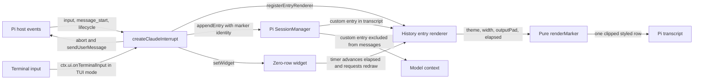
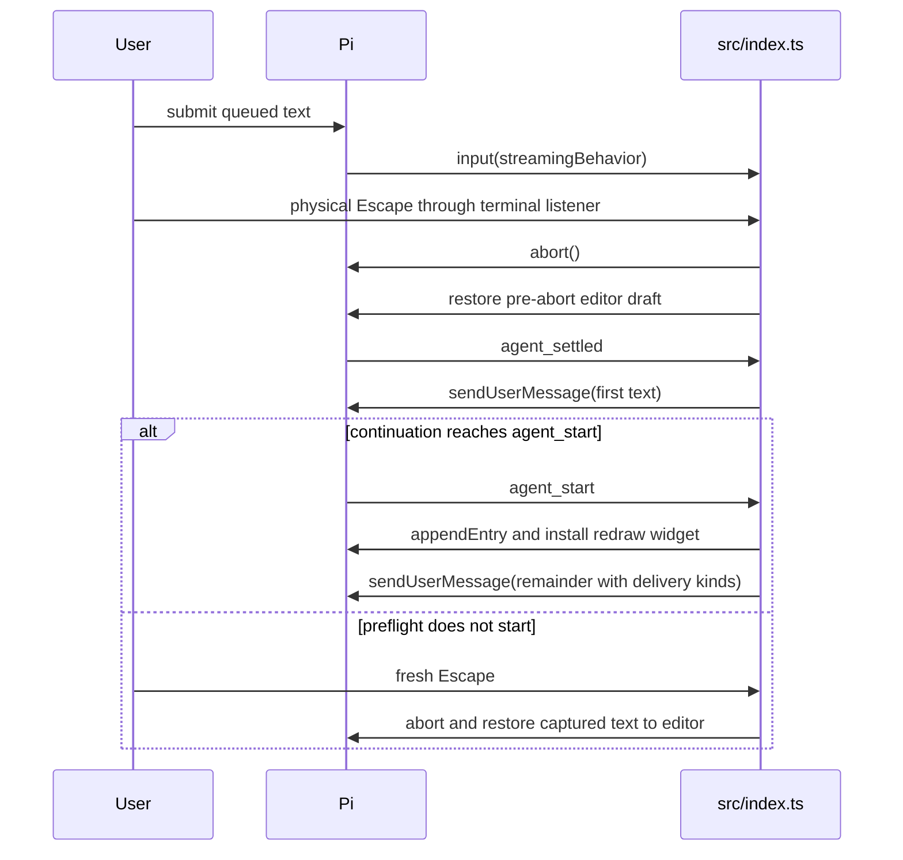

# Architecture

Status: current system; one source module, no proposed runtime modules.
Evidence: surveyed on 2026-10-07 at base revision `bb1ba4a`, reading all of `src/index.ts`, both `test/*.test.ts` files, `package.json`, `tsconfig.json` and the existing README. This describes this package, not a review of other extensions or a provider-backed end-to-end run.

## System and module map

The diagram's internal nodes are functions and registered components within the same source module, not separate files.

| Module/path | Purpose | Public entry point | Dependencies |
| --- | --- | --- | --- |
| `src/index.ts` | The only source module: queue observer, Escape/replay lifecycle and marker | Default `createClaudeInterrupt`; named `createClaudeInterrupt` and `renderMarker` for tests | Node `randomUUID`, Pi extension types, Pi TUI key/color/width helpers; design-system exported cells/palette, transcript-marker, flash/ping/wipe subpaths |
| `package.json` | Standalone package discovery and checks | `pi.extensions` points to `./src/index.ts` | Host peer packages; pinned development packages |
| `test/extension.test.ts` | Queue harness, renderer and timer contracts | Node test runner | Named source exports, real Pi Theme and TUI helpers |
| `test/extension-runner.test.ts` | Loader, asynchronous events, terminal routing and session persistence | Node test runner | Real Pi loader, ExtensionRunner, TuiMainScreen and in-memory SessionManager |

The marker imports the in-repo design-system package through the root install; there is no extension-local runtime dependency, database or custom storage layer. The runtime entry receives Pi's API; `renderMarker` receives explicit display inputs and does no I/O or clock reads.

## Representative flows

### Interrupt and continue

1. `input` observes entries with `streamingBehavior`, retaining text, delivery kind and an image-presence flag. Matching extension-origin replay inputs are consumed from `expectedReplay` so they are not captured twice. Pi's dequeue key (`app.message.dequeue`, Alt+Up) empties Pi's queue without an extension event, so a submission that finds Pi's queue empty first discards the stale observation. `message_start` removes delivered user messages, steering first, except the already-accounted-for continuation head.
2. `session_start` resets state and installs `ctx.ui.onTerminalInput` only in TUI mode. Escape release resets ownership without acting; repeats are consumed only for an extension-owned press. A genuine press first finalizes any animation.
3. With no pending core messages, no observed text, or an observed image, the press falls through to native handling. Otherwise it captures the queues, enters `aborting`, saves the draft and calls `ctx.abort()`. Pi's TUI abort prepends its real cleared queue to the editor. Only when that text equals the observed queue joined in Pi's format does the extension restore the exact draft and continue; otherwise it leaves Pi's native restoration in the editor and abandons the interrupt, so it never replays text that was not in Pi's queue.
4. A second press during `aborting` is idempotent. Text arriving during this window is held separately as raced text; it also stays in Pi's queue, where Alt+Up can still dequeue it, so a raced submission that finds Pi's queue empty first discards earlier raced text. A late image is explicitly handled and rejected with a warning; its text is prepended to the editor and the earlier batch remains intact.
5. At `agent_settled`, any raced core queue is cleared by another abort. Raced text joins the replay only if that abort restored exactly it; then the draft is restored. Otherwise (dequeued, changed or unobserved), Pi's restoration stays in the editor and only the batch verified at Escape continues. The extension enters `starting`, records expected replay input, and sends the first ordered text with prompt-template expansion. It does not send the head before settlement.
6. At `agent_start`, the extension appends its marker in TUI mode, tracks the undelivered remainder as ordinary pending queues, and sends that remainder with original delivery kinds and prompt-template expansion. It clears interrupt state and skips the head's next user start. A new Escape can interrupt that remainder again.
7. If preflight never reaches `agent_start`, there is no marker. A fresh Escape clears restart tracking, requests abort, and prepends every captured text to the editor. The head was already sent, and Pi ignores an abort until its run is active, so the extension acts on how far that one replay has got (`sent`, `input`, `preparing`):
   - Before its input event, the `input` handler drops the head's own extension-origin input (same text, no images). Any input from the user ends the tracking.
   - Past its input handlers, only the next run to reach `before_agent_start` is checked. Any new input ends the tracking, so a failed preflight cannot affect a later template or message.
   - Past this extension's own `before_agent_start`, the next `agent_start` is aborted.
   - Whenever the head does start, it is aborted again at `agent_start` with a warning, which also covers hosts that lose an abort during preparation.

### Marker rendering

`renderMarker` composes `markerPlate` and `markerBars` with the `flash` interrupt preset, `ping`, and `wipe`. The design system owns roles, piece styles, offsets and motion timing; the lifecycle takes its frame interval and completion window from `MARKER_TIMELINE`. No extension hex constants or duplicated timeline remain.

The private `markerLine(theme, line)` adapter resolves role/RGB styles with `resolveStyle`, maps explicit terminal defaults to absent Pi foreground/background channels, and maps only transparent accent ink to Pi's accent on light themes. Equivalent concrete styles coalesce into Pi `theme.style` runs. Pi still owns truecolor/256-color conversion and final `truncateToWidth` clipping to `width - outputPad`; styling before clipping preserves the original narrow-width SGR bytes. The adapter is pure, does not read session state, and is host-specific rather than a design-system Pi dependency.

Colocated design-system `.d.mts` files type these imported subpaths under strict NodeNext without changing TypeScript settings or the exports map. Compile-only contracts are in `test/design-system-types.ts`.

### Marker animation lifecycle

`agent_start` creates a unique live identity, start time and elapsed frame state. `appendEntry("claude-interrupt-steering", { id })` creates the history record; only the matching live identity animates. A zero-row widget supplies a TUI redraw handle and disposal callback, never a second visible marker.

One timeout advances elapsed time by at least one frame or catches up to the elapsed wall-clock frame, whichever is later. It clamps to the animation window and schedules no more than 75 callbacks. Late wake-ups skip missed frames, and a backward clock jump cannot keep scheduling indefinitely. The exact visual timeline is in [design](design.md#directive-updated-marker).

Completion, a fresh Escape, widget disposal, session reset, shutdown, reload or switch finalize the entry and cancel the timer. `disposeAnimation` clears live state before requesting the final redraw; `clearAnimation` also removes the widget. The widget's own disposal does not recursively call `setWidget`. Ordinary messages and tool actions do not remove the history row. Saved entries render settled without restarting animation.

Shutdown freezes the last `outputPad` as plain data before reset. Retained entry components can still render while Pi replaces the transcript, without calling an invalidated runtime. A new runtime renders saved entries with its own settings.

## Data and contracts

- Pi owns the real queue. Extensions receive no dequeue event and can read the queue only through the text TUI abort restores to the editor, which is checked before any replay. `PendingQueues` is only an observer: separate steering/follow-up arrays of `{ text, deliverAs, hasImages }`. `InterruptState` is either `aborting` or `starting`; no interrupt is `undefined`. `expectedReplay`, `skipNextUserStart` and Escape ownership prevent duplicate observation and accidental native aborts of a restarted run.
- Public APIs relied on: `pi.on` for input/message/session/agent events; `ctx.mode`, `ctx.hasPendingMessages`, `ctx.abort`; UI terminal subscription, editor get/set and warning notification; `pi.sendUserMessage`; entry renderer registration, `appendEntry`, `setWidget`, and `pi.getSettings().outputPad`. TUI key helpers distinguish press/repeat/release; `theme.style` and `truncateToWidth` own styling and clipping.
- Pi's queue and abort APIs do not expose an atomic "abort but retain this structured queue" operation. Observation followed by replay after `agent_settled` is not an atomic transaction or an exactly-once guarantee for arbitrary external queues.
- Durable data is only the custom marker entry with its UUID. Pi's session manager persists it as history, not as a model message. Queues, timers and animation state are transient; they are not serialized. Do not replace `appendEntry` with a context-bearing message API.
- Verify these assumptions against the documentation and public types of the Pi version being changed, not merely the wildcard peer range. [Compatibility](../README.md#compatibility) and [verification records](../CONTRIBUTING.md#verification-records) bound current evidence.

## Critical invariants

All code pointers below are within `src/index.ts`. Test titles identify existing checks, not proposed coverage.

| Must remain true | Relevant code | Test/check |
| --- | --- | --- |
| Replay waits for settlement and preserves the draft | Terminal listener and `agent_settled` | `extension.test.ts`: "Escape interrupts one queued text and continues only after settlement" |
| Steering precedes follow-ups and delivered text is not replayed | `ordered`, `message_start`, `agent_start` | `extension.test.ts`: "several messages retain Pi's steering-before-follow-up order without duplication"; `extension-runner.test.ts`: "real ExtensionRunner asynchronously re-interrupts a replayed queue without delivered duplicates" |
| Only text still in Pi's queue at Escape is replayed; dequeued or differing text keeps Pi's native restoration | `input` resync and `restoredEditorText` check | `extension.test.ts`: "a directive cancelled with Pi's dequeue key is not replayed; the kept one still continues" and "Escape leaves Pi's restored queue in the editor when it differs from the observed text"; `extension-runner.test.ts`: "a directive cancelled with Pi's dequeue key is never replayed by a later Escape" |
| Native no-queue behavior and abort idempotence remain available | Terminal listener | `extension.test.ts`: "Escape without a core queue remains native and an unsent draft is not a queue" and "repeated Escape while abort is settling is consumed without aborting twice" |
| Unsupported images are never silently replayed as text | `input` and image guard | `extension.test.ts`: "queued image attachments fall back to Pi's native Escape" and "a late image is rejected without discarding the captured text batch" |
| Abort-window text is replayed once, and only if still in Pi's queue at settlement | `input`, `agent_settled` | `extension.test.ts`: "text submitted during abort settlement is cleared once and replayed once", "text submitted after Escape and dequeued before settlement is not replayed" and "raced queue that differs from the observed text stays in the editor, unreplayed"; `extension-runner.test.ts`: "text submitted after Escape and dequeued before settlement is never replayed" |
| A head restored by recovery Escape never runs to a response, and unrelated work is untouched | `InterruptState.head`, `abandoned` and `stopAbandonedRun` in `input`, `before_agent_start`, `agent_start` | `extension.test.ts`: "a recovered head that still starts is aborted at before_agent_start and reported", "a recovery Escape after the head's own start hook still aborts it when it starts", "after a failed recovered preflight, an equivalent template or extension message is untouched", "an aborted head that never reaches agent_start cannot abort a later run" and "resubmitting a recovered head yourself keeps that run"; `extension-runner.test.ts`: "a recovery Escape before the replayed head reaches input handlers drops it", "a pending recovered head is dropped without dropping another extension's same-text message", and both host models of the recovery-after-input and recovery-after-start-hook tests |
| Failed preflight leaves recovery Escape usable | `starting` branch | `extension-runner.test.ts`: "real ExtensionRunner leaves Escape available after asynchronous start failure" |
| Marker confirms continuation only and never enters model context | `agent_start`, `appendEntry` | `extension.test.ts`: "marker waits for confirmed continuation and stays out of ordinary, native and non-TUI paths"; `extension-runner.test.ts`: "real ExtensionRunner persists exactly one non-context marker at start and reloads it completed" |
| Renderer is deterministic, clipped and aligned | `renderMarker` | `extension.test.ts`: "marker rows fit every width from 0 to 160 in every frame, pad and color mode, clipping instead of reflowing" and "marker label starts on the same column as Pi's native abort notice for outputPad 0/1" |
| Timers are bounded and disposed on every animation exit | `schedule`, `advance`, `clearAnimation`, `reset` | `extension.test.ts`: "late timer wake-ups catch up and wall-clock jumps cannot extend the bounded animation" and "Escape, widget disposal and session cleanup finalize history and cancel every timer" |
| Owned repeats do not reach native abort; release never acts | Terminal listener | `extension-runner.test.ts`: "real TUI keeps owned repeats out of native focus across failed preflight and live continuation" and "real TUI routes Kitty release before focus without ending continuation feedback" |
| Retired components do not call an invalidated runtime | `currentOutputPad`, shutdown | `extension-runner.test.ts`: "real ExtensionRunner keeps retained marker components renderable after session replacement" |

Tests are in [test/extension.test.ts](../test/extension.test.ts) and [test/extension-runner.test.ts](../test/extension-runner.test.ts). Their isolated session bridge is not provider end-to-end verification.

## Where the next change belongs

An Escape race fix belongs in the existing input/settlement state machine, with a harness regression and a real-runner ordering check. Keep the renderer unchanged. A marker appearance change belongs in the design-system pieces/motions and the Pi adapter in `renderMarker`, with cell/frame tests and design updates; it must not change queue semantics. A lifecycle change belongs in `createClaudeInterrupt`, preserving entry identity and disposal and adding real-loader coverage where the host boundary changes.

Keep one source module while these behaviors remain cohesive. Extract a module only for a real independently changing responsibility, not a hypothetical shared UI package. Any marker data change must keep existing saved entries renderable in a settled state and test reload/session replacement; no schema migration exists today.

## Evolution and known limits

- **Structured content:** queued images/attachments are unsupported. An observed image triggers native Escape rather than lossy replay; an image submitted after interruption begins is rejected with a warning and its text restored. Exact structured semantics require a public atomic queue snapshot plus abort/requeue API, or a native interrupt-and-continue operation.
- **Input-transforming extensions:** unsupported in combination. Replay passes through Pi's input pipeline again, so another extension can transform text twice or handle it differently. The replay observer is not a composition protocol.
- **Compaction-time queue:** unsupported because Pi keeps it inside the interactive UI and does not expose it to extensions.
- **Slow restart preflight:** Pi has no API to withdraw a prompt that has passed its input handlers, and every started run records its prompt. A recovered head that still starts is aborted at `before_agent_start` when it reaches it after recovery, and always at `agent_start`. On Pi 1.4.0 an abort during preparation stops the run before the first provider request (read from Pi's source, not checked interactively). On Pi 0.99.1 that abort is lost, and the `agent_start` abort stops the running agent; whether a request was already in flight then depends on the host. Either way the directive stays in the transcript, and so in later context, and a warning says so. If you submit anything while the head is past its input handlers, tracking ends and the head is not stopped. Removing it would need a history rewrite such as a `context_edit` entry, which this extension does not do. If its preflight fails, tracking ends at the next input or run.
- **Overlapping prompts during recovery:** Pi gives a prompt no identity that extensions can see, so the recovered head is recognized by stage and text.
  - If another extension submits the identical text (with no images) while the old run settles, Pi runs the deferred prompts in order. The other message can then be dropped in place of the head, which then runs.
  - On Pi 0.99.1, a session is not busy while `before_agent_start` handlers run, so two runs can prepare at once. A recovery after both have passed this extension's hook can abort whichever starts first, and the head may then run. On Pi 1.4.0 the session is busy from the start of preparation, so later prompts queue instead.
  - Both cases need a host prompt identity to fix. The second could be narrowed by counting runs in preparation; that is deliberately not done (operator decision, 2026-10-29).
- **Unobserved or differing queue:** when Pi reports pending messages but this observer has no queued text at all, Escape falls through. When Pi's restored queue differs from the observed text, Escape behaves natively: the run aborts and the queue stays in the editor. This includes queued prompt templates and skill commands, which Pi queues expanded, and text changed by another extension's input handler.
- **Terminal behavior and motion:** physical-key ownership, legacy-repeat ambiguity and the absence of reduced-motion controls are specified in [design](design.md#accessibility-and-platform-behavior). Remapping native interrupt does not change this extension's input seam.
- **Evidence:** no interactive Pi/Herdr verification for the move, and no measured production performance baseline. Measure a suspected redraw or large-queue problem before adding a cache, scheduler layer or service. Revisit observer design only when a concrete host contract or requirement changes.

## Technical decisions

None recorded. No decision directory is needed for this documentation conversion.
