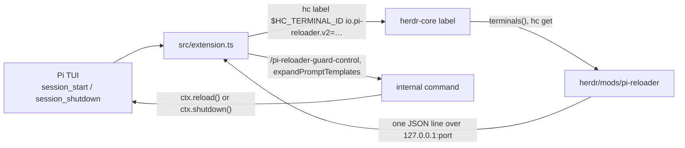

# Architecture

Status: current at contract version 2. Evidence: `src/extension.ts`, its tests, Pi 1.5.2's `dist/core/extensions/types.d.ts` and `docs/extensions.md` (`ctx.reload`, `ctx.shutdown`, `sendUserMessage` with `expandPromptTemplates`, session events), `hc --help` and herdr-core 0.1.20's `hc --skill`.

## Modules and dependencies

| File | Owns | Depends on |
| --- | --- | --- |
| `src/extension.ts` | The listener, the `io.pi-reloader.v2` label, request validation, the internal command and the reload and quit actions | Pi's extension API (type imports only, host peer `@earendil-works/pi-coding-agent`); Node's `net`, `crypto`, `fs` and `child_process`; `hc` on `PATH` |
| `test/extension.test.ts` | The guard against a stub Pi and a fake `hc`, over its real loopback listener | Node's test runner |

There is no other runtime dependency and no design-system import: the guard draws nothing but one warning. Its only client is the Herdr desktop mod in `herdr/mods/pi-reloader/`; they share [the contract](contract.md), never code.

## Flow

1. `session_start` in the TUI with `HC_TERMINAL_ID`: make a token, listen on `127.0.0.1:0`, publish the label. A failure shows one warning and leaves the guard unpublished.
2. A connection sends one line. The guard validates version, token and action (and the session for an action), then answers a probe with its state, or refuses a non-ready action with that state.
3. A ready action is held as the one pending request and dispatched as the internal command with a one-time value. Only a command context has `reload()`; dispatching through `sendUserMessage(…, { expandPromptTemplates: true })` is Pi's documented way to run it, and the text never reaches the editor or the model.
4. The command validates again and rechecks state, replies `accepted`, marks the guard closing and calls `ctx.shutdown()` or `await ctx.reload()`, and returns without touching the old runtime.
5. `session_shutdown`: refuse new work, drop a pending request, close the listener, and on `quit` clear the label. On reload and session switch the next runtime publishes its own label.

## State

Per extension instance: the listener, the token, a `closing` flag, whether the label was published, and at most one pending request. Nothing is written to disk or the session.

## Host seams

- `ctx.isIdle()`, `ctx.hasPendingMessages()`, `ctx.ui.getEditorText()` decide `ready`, `draft` and `busy`.
- `ctx.sessionManager.getSessionFile()` is the session, reported only once the file exists.
- Pi has no restart API in 1.5.2 (`reload` and `shutdown` only), so a reset is a quit here and a resume typed into the root shell by the mod; see [the decision](../../../docs/decisions/pi-reloader-desktop.md).
- Pi itself reports its status to Herdr with OSC 7501 (`dist/modes/interactive/program-status-reporter.js`); the guard does not.

## Critical invariants

| Must remain true | Check |
| --- | --- |
| Drafts are never read out, written, cleared or submitted | `test/extension.test.ts` |
| An action needs the right token and session, and a final ready check with no await before the native call | `test/extension.test.ts` |
| A reload keeps the label for the next runtime; a quit clears it | `test/extension.test.ts` |
| Nothing listens or publishes outside the TUI or without `HC_TERMINAL_ID` | `test/extension.test.ts` |
| The extension loads in the installed Pi | Step 2 in [contributing](../CONTRIBUTING.md#validation-sequence) |

## Limits

- A crashed Pi leaves its label; the mod reports no guard when the port does not answer.
- Loopback only: Pi on another machine is not reachable.
- The guard trusts any process of the same user that can read herdr-core labels; see the [README](../README.md#privacy-and-limits).
